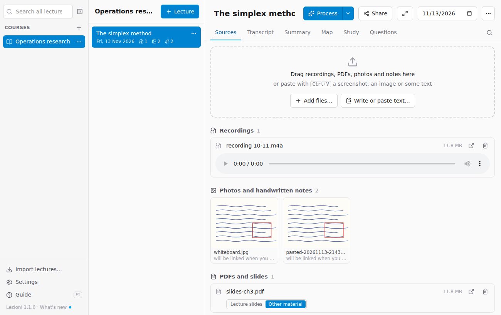
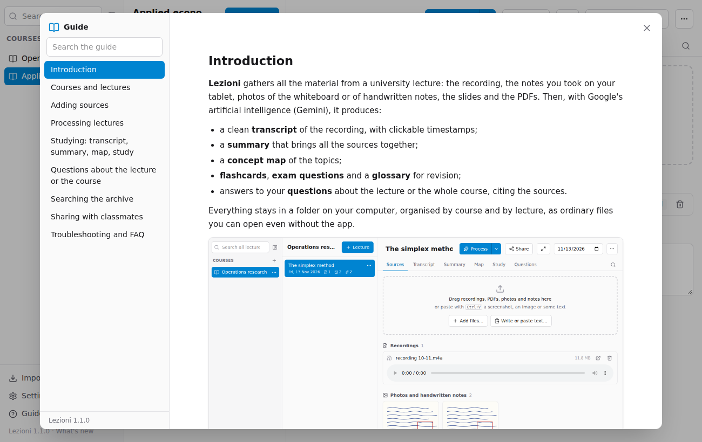
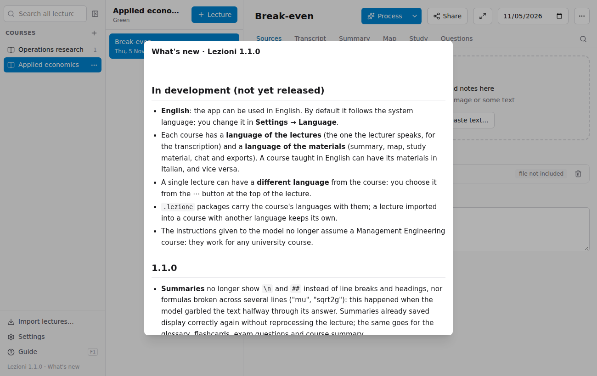

# Introduction

**Lezioni** gathers all the material from a university lecture: the recording, the notes you took on your tablet, photos of the whiteboard or of handwritten notes, the slides and the PDFs. Then, with Google's artificial intelligence (Gemini), it produces:

- a clean **transcript** of the recording, with clickable timestamps;
- a **summary** that brings all the sources together;
- a **concept map** of the topics;
- **flashcards**, **exam questions** and a **glossary** for revision;
- answers to your **questions** about the lecture or the whole course, citing the sources.

Everything stays in a folder on your computer, organised by course and by lecture, as ordinary files you can open even without the app.

## How the window is laid out

- **On the left**: search, the list of **courses** and, at the bottom, *Import lectures…*, *Settings* and this *Guide*.
- **In the middle**: the **lectures** of the chosen course, most recent first.
- **On the right**: the open lecture, with the **Sources**, **Transcript**, **Summary**, **Map**, **Study** and **Questions** tabs.

Drag the edge of a column to make it wider or narrower; double-click the edge to bring it back to its original size.

## The usual workflow

1. Create the course and the lecture ([Courses and lectures](02-archivio.md)).
2. Drag in the recording, notes and slides ([Adding sources](03-fonti.md)).
3. Press **Process** ([Processing lectures](04-elaborare.md)).
4. Study from the Summary, Map and Study tabs ([Studying](05-studiare.md)) and ask questions ([Questions](06-domande.md)).
5. Share the lecture with your classmates ([Sharing](08-condividere.md)).

You can open this guide at any time with **F1** or with **Guide** at the bottom left. On the left there is the table of contents, with a search through the text of the guide.

Below the Guide there is the app's **version** (for example *Lezioni 1.1.0 · What's new*): click it to read what is new in each version. A blue dot next to it means the app has been updated and there is news you have not read yet.

