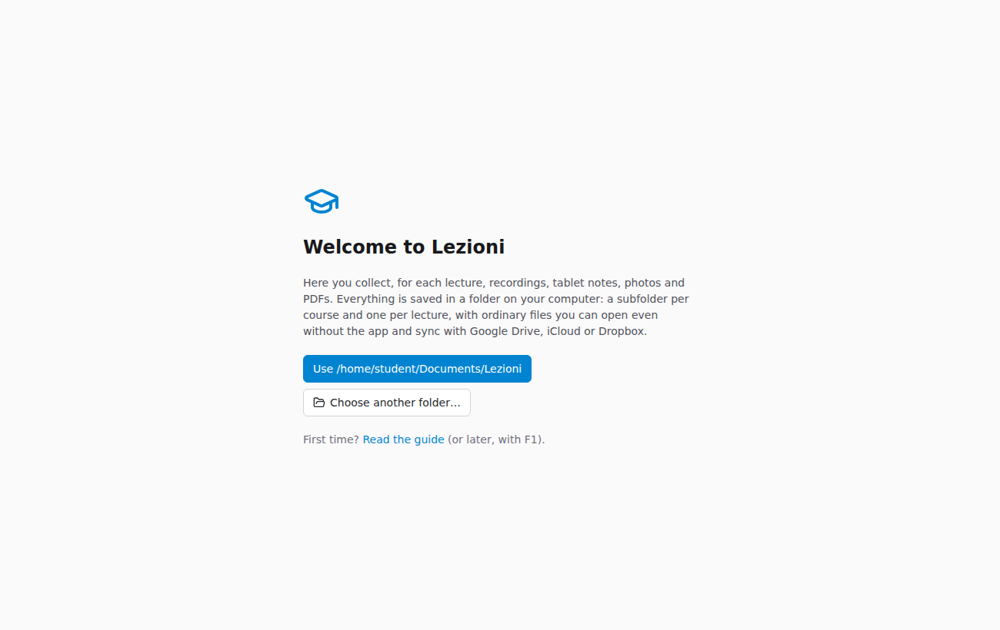
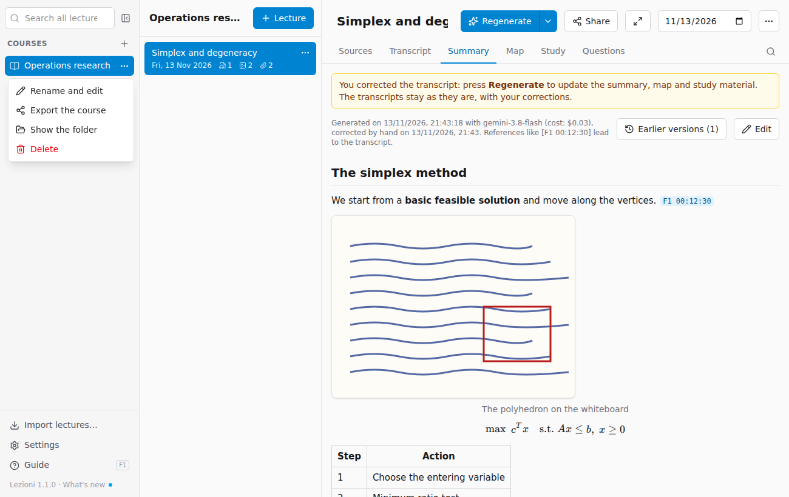
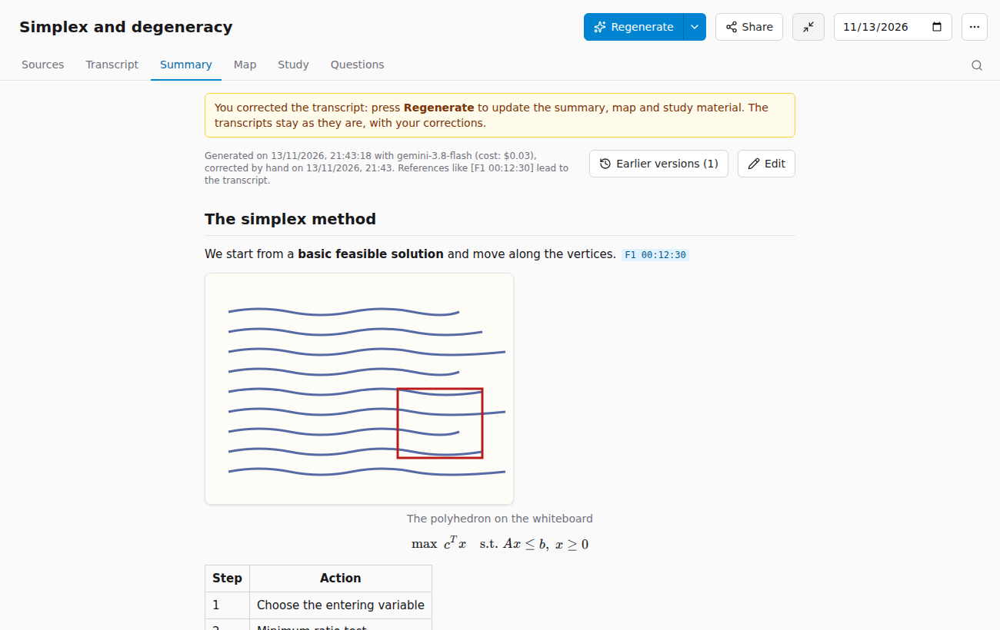
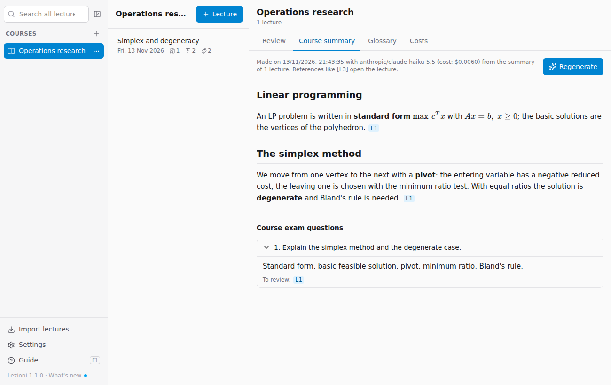
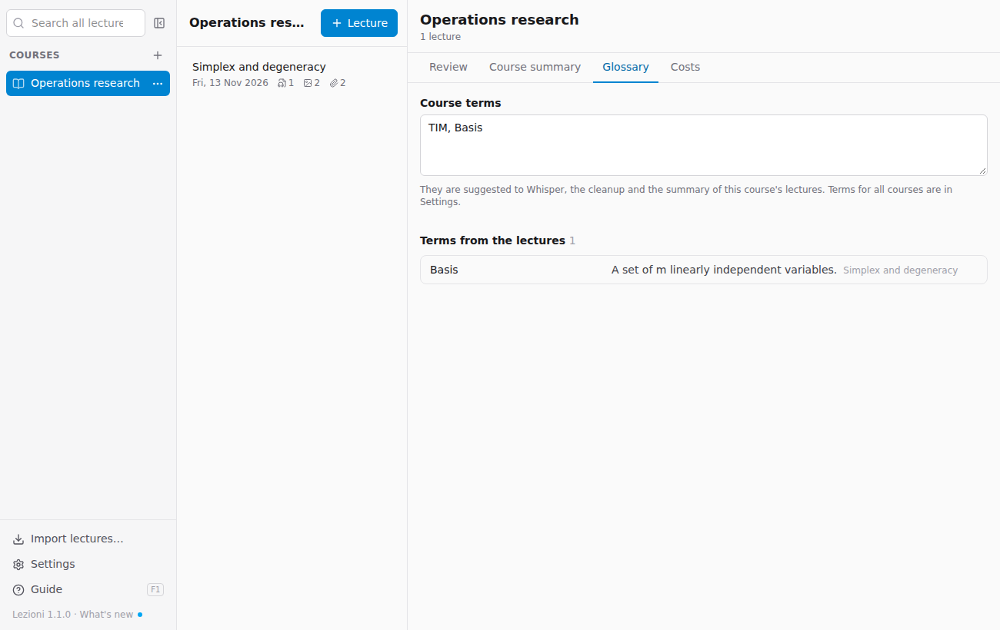
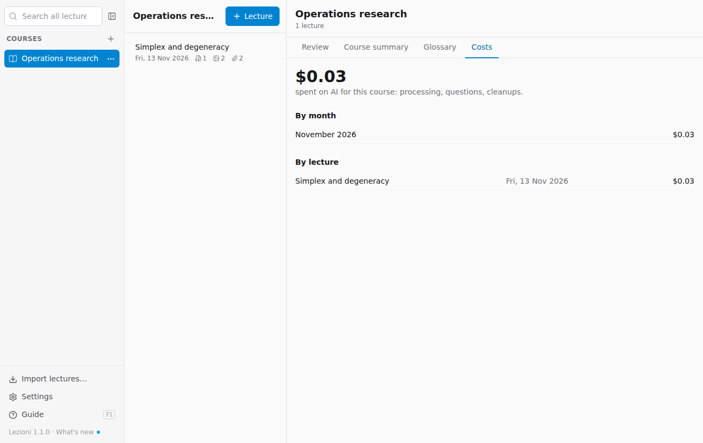

# Courses and lectures

## First launch: the archive folder

The first time you open the app, it asks where to keep the archive. It suggests the **Documents/Lezioni** folder; you can choose another one, even inside Google Drive, iCloud Drive or Dropbox, so the archive syncs by itself and you always have a copy.



The archive is made of ordinary folders (the folder names below are the app's own and stay in Italian):

```
Lezioni/
  Ricerca operativa/                   (a course)
    2026-11-10 Metodo del simplesso/   (a lecture)
      fonti/       the files you added (sources)
      estratti/    the text read from each source (transcripts, notes), Whisper's
                   text (.whisper.md) and copies of your corrections (versioni/)
      generati/    summary, map, flashcards
    generati/      course summary
```

You can open these files even without the app. You change the folder in **Settings**: to move the archive, move the folder and then choose it there.

## Courses

- **New course**: the **+** next to *Courses*. The lecturer is optional.
- **Course terms**: on the course page, **Glossary** tab (or ⋯ → *Rename and edit*), you can write the technical terms and names that come up often, separated by commas and spelled correctly: for example `ARERA, colpo d'ariete, cassa d'aria, Gauckler-Strickler`. They are suggested to Whisper, to the cleanup and to the summary, so these make fewer mistakes; they apply from the next processing on. You can also add one while correcting a transcript.
- **Terms for all courses**: names and acronyms that come up in several courses (the name of the university, organisations, lecturers) are written only once in **Settings → Terms for all courses**. They apply to every course, after its own terms. They are kept in the archive's `parole.txt` file, so they follow the archive if you sync it.
- The **⋯** button next to the course (always visible on the chosen one, on the others when you hover over them) opens the menu with **Rename and edit**, **Export the course**, **Show the folder** and **Delete**.



- The button next to the search field **hides the courses column** to leave more room; the same button at the top of the list of lectures brings it back. Searching all lectures is done from that column.
- Clicking the **course name** at the top of the list of lectures opens the **course page** (see below). It also opens when you choose a course and no lecture.
- Deleting a course moves it to the **Trash** with all its lectures: you can recover it from there.

## Languages

Lezioni works in **English** and in **Italian**, and keeps three languages separate:

- **The app's language** (menus, buttons, messages): **Settings → Language**. By default it follows the system: English, unless your computer is set to Italian, in which case it is Italian.
- **The language of the lectures**: the one the lecturer speaks. It is chosen for each course, in the course window (**+** next to *Courses*, or ⋯ → *Rename and edit*). It is used for the transcription: Whisper hears better if it knows which language to listen for, and the cleanup never translates. If one lecture is in a different language (a guest speaker, an Italian seminar in an English course), change it from the **⋯** button at the top of the lecture, under *Language spoken in the lecture*: *Course language*, *Italian* or *English*.
- **The language of the materials**: the one in which the summary, map, glossary, flashcards, exam questions, course summary and chat answers are written. It is chosen for each course, next to the language of the lectures. For example, a course taught in Italian with the materials in English: the transcript stays in Italian, the summary is in English and, the first time, gives the original technical terms in brackets.

A new course takes the app's language for both; courses created before version 1.2 are in Italian. Photos and PDFs are read in the language they are written in, whatever the course's language. Exports (web page, PDF, Markdown, Anki) use the language of the materials.

Changing the language of a course or a lecture does not redo anything by itself: to transcribe again use **Process the sources again too**; to rewrite only the materials in the new language, use **Regenerate** (see [Processing again](04-elaborare.md#processing-again)).

## Lectures

- **+ Lecture** at the top of the list: title (you can change it later) and date, which is today by default.
- You edit the **title** by clicking on it on the lecture page, and the **date** from the field next to it. The folder name follows the title and date.
- In the list, next to the date, icons count recordings, photos and other files.
- With more than six lectures, a field appears for filtering them.
- The **⋯** button next to a lecture in the list (or at the top of the open lecture) has **Share…**, **Show the folder** and **Delete** (it goes to the Trash, where you can recover it).
- The **Full screen** button at the top of the lecture (the two arrows) hides courses and lectures and gives the whole window to the open lecture; **Esc** or the same button take you back. To make the window itself full screen, use the Mac's green window button.



- At the bottom of the **Sources** tab are the **lecture notes**: topics, things to review, assignments. They are used for the summary too.

## The course page

It gathers everything about the course as a whole.

### Review

The flashcards from all the course's lectures that are due today, just like reviewing a single lecture (see [Study](05-studiare.md#spaced-review)). Above each card is the lecture it comes from: click it to open that lecture.

### Course summary

A summary of **the whole course** for exam preparation, built from the lecture summaries: it is organised by topic, not lecture by lecture, and connects what was explained on different days. Below it are the **course exam questions**: those proposed for the individual lectures, merged and chosen among the most recurrent, each with an answer outline and the lectures to review.

- **Generate the course summary** creates it (at least one processed lecture is needed); then **Regenerate** redoes it, and the previous one stays in `generati/versioni` in the course folder.
- The references **L1**, **L2**… show which lectures each paragraph comes from, oldest first: click them to open the lecture.
- When you add or reprocess lectures, the app warns you that the course summary is out of date.
- It costs little: it is made from the summaries, not the transcripts, so a few thousandths of a dollar per lecture with the default models.



The course summary is not included in packages: whoever receives them generates it from their own lectures.

### Glossary

At the top are the **course terms** (see above), which you can write or correct right here. Below are the **terms from the lectures**: the glossaries of all the lectures merged in alphabetical order, with the definition and the lectures they appear in (click them to open them). **+ course terms**, next to a term, adds it to the course terms with one click.



### Costs

How much you have spent on AI for the course: the total, month by month and lecture by lecture. It counts processing (including runs that were cancelled or ended with an error, for the part already done), questions and cleanups. Click a lecture to open it.



With OpenRouter the cost is the real one, reported by the service. With Gemini the service does not report it: the app estimates it at the paid tier's price, and says so. For lectures processed before this version, only the last processing is counted. The log is in the lecture's `costi.json` file and is not included in the packages you share.
