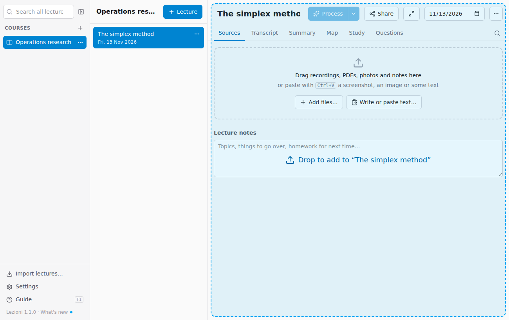
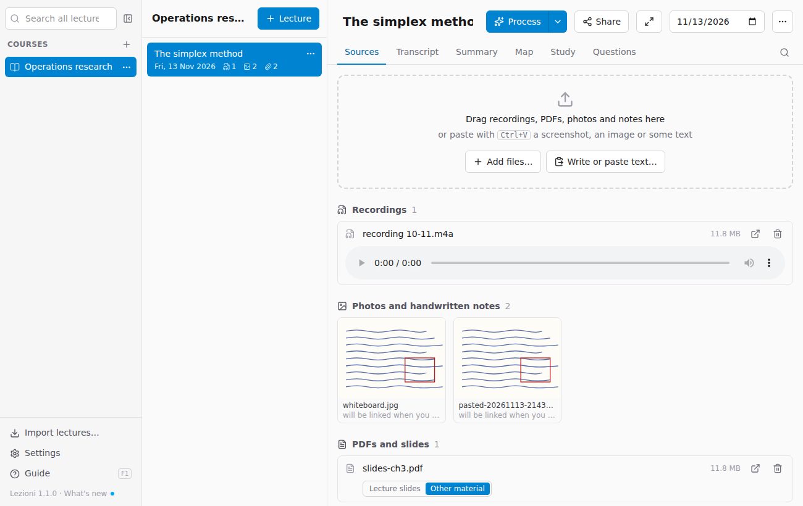
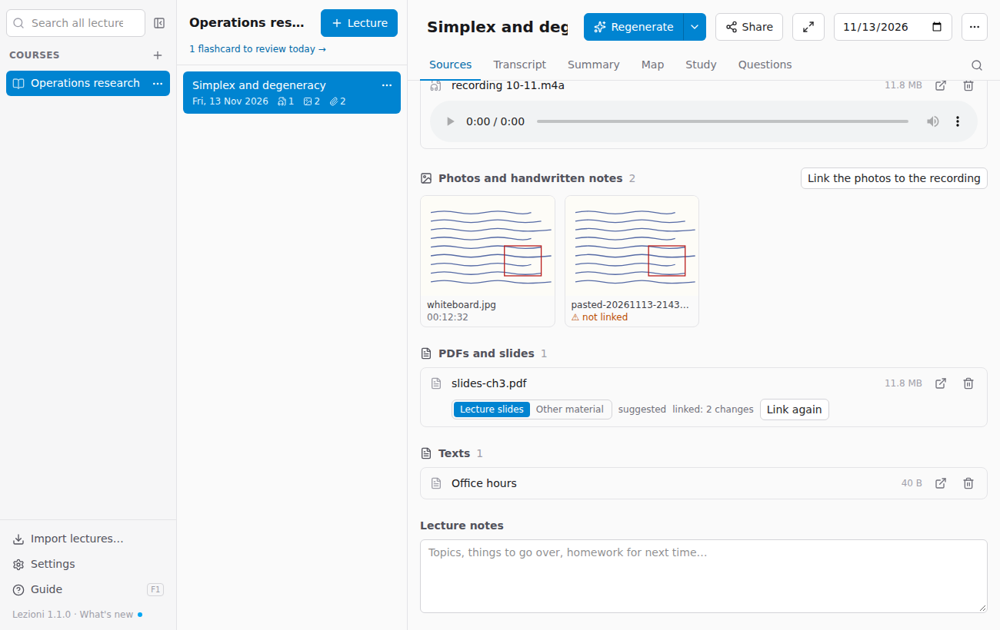
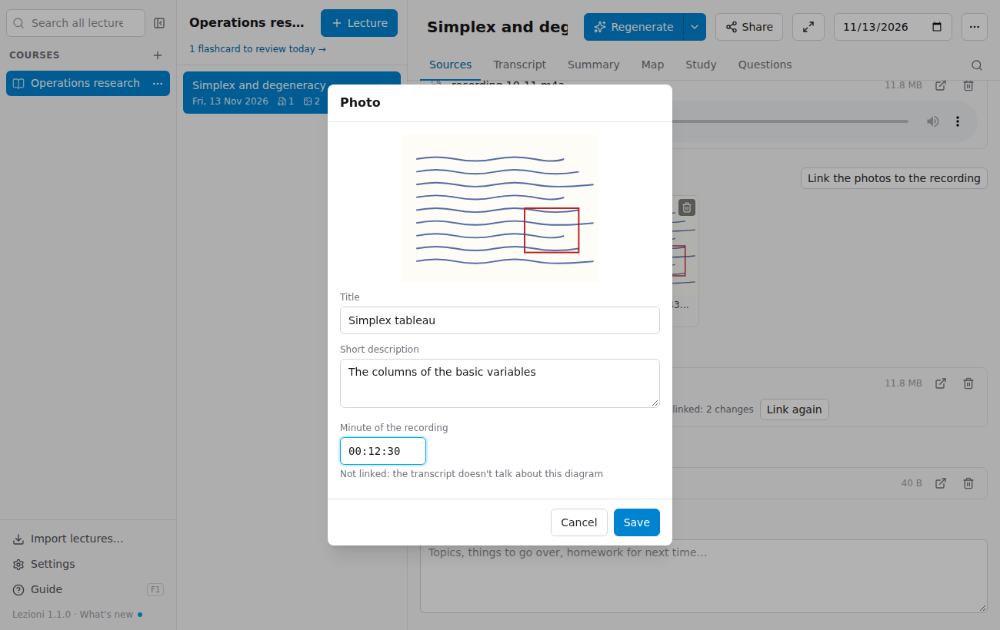
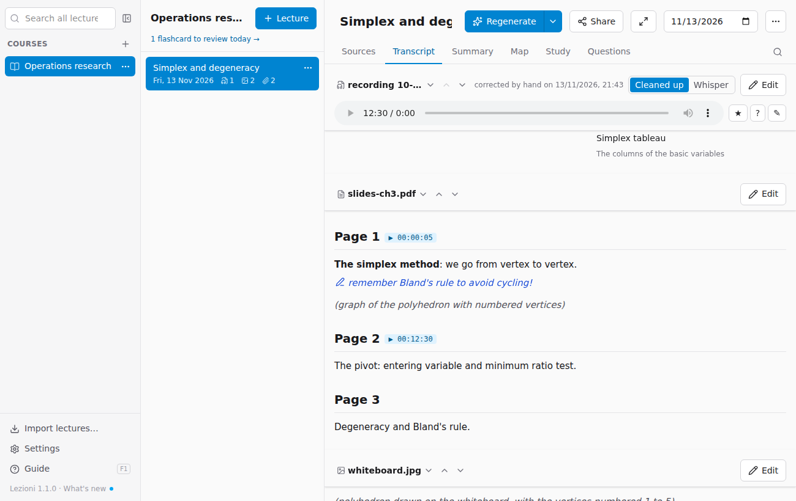

# Adding sources

**Sources** are everything that belongs to the lecture: recordings, photos, tablet notes, slides, PDFs, text. Files are **copied** into the lecture folder: the originals stay where they are.

## Dragging files

Drag files from Finder or File Explorer onto the open lecture: the window changes colour and, when you drop them, the files are added.

Alternatively, use **Add files…** to choose them from a window.

## Pasting

With **⌘V** (Mac) or **Ctrl+V** (Windows), outside a text field:

- a **screenshot** or a copied image (for example from your tablet's note-taking app) becomes a photo of the lecture;
- **text** opens a window where you give it a title before adding it.

**Write or paste text…** opens the same window for typing by hand. The text can be in Markdown.

## Which files work

| Type | Formats | Notes |
|---|---|---|
| Recordings | m4a, mp3, wav, aac, ogg, flac, opus | m4a (iPhone Voice Memos and almost all Android recorders), mp3, wav, flac and ogg are split by the app into 20-minute parts and cost less; opus and rare formats are sent whole |
| Video | mp4, mov, webm | The audio is transcribed |
| Photos and notes | jpg, png, heic, webp | Handwritten notes, whiteboard, tablet pages exported as images |
| PDF | pdf | Slides, handouts, notes exported from the tablet |
| Text | txt, md | Used as it is |
| Office | docx, pptx, … | Not read: export them to PDF and add the PDF |

Sources are grouped by type. You can listen to recordings right on the page; photos are shown as thumbnails. The arrow button opens the file with the system's app; the bin removes it from the lecture: the **copy** that Lezioni keeps in the archive goes to the computer's Trash (the original file you dragged in stays where it was) and its transcript or extracted text is deleted, so removing a recording that was already transcribed means it has to be transcribed again if you add it back.

> **Tip for tablet notes.** If you use GoodNotes, Notability, OneNote or similar, export the lecture's pages as a **PDF**: a multi-page PDF is a single source and is read better than lots of photos.

## Lecture slides or other material

In Sources, below each PDF, choose what it is:

- **Lecture slides**: the slides the lecturer was showing while speaking. The app **links them to the recording**: it finds the minutes at which the lecturer moves from one slide to the next (with the reading model, about a thousandth of a dollar per lecture). In the Transcript you see them next to the text (see [Studying](05-studiare.md#slides-alongside-the-transcript)).
- **Other material**: notes, handouts, exercises, extra documents. They are kept separate: they go into the summary, but are not linked to the recording.

When it reads a PDF, the app suggests the type by itself ("suggested" appears next to it); if it gets it wrong, change it with one click. Linking happens by itself when you process the lecture; after changing the type you do not need to reprocess: **Link to the recording** does it right away, **Link again** redoes it.

## Photos linked to the recording

Photos (the whiteboard, a page of notes, a photographed slide) are **linked to the minute** of the recording at which the lecturer talks about them. That way, in the Transcript you see them next to the text, and in the summary they appear in the right place (see [Studying](05-studiare.md#photos-alongside-the-transcript)). Linking happens by itself when you process the lecture:

- if the photo has the **time it was taken** (photos taken with a phone do) and the start time of the recording is known, the minute is calculated from the times: it is precise and costs nothing. Photos sent via WhatsApp and pasted screenshots lose the time;
- otherwise the reading model compares the text read from the photo with the transcript (about a thousandth of a dollar per lecture).

Below each photo is the minute it is linked to, or **⚠ not linked** in orange when the app has not found the spot: hover over it to see why, and you also find it among the warnings at the end of processing.

The pencil on the photo opens its card:

- **Title** and **Short description** are optional: write what it shows and which part of the lecture it belongs to ("Il poliedro dei vertici" [the vertex polyhedron], "esercizio sul pivot" [pivot exercise]). The model uses them to link the photo, and the title appears in the transcript and in the summary instead of the file name;
- **Minute of the recording**: type it (for example `00:12:30`) to link it yourself. **Unlink** removes it from the recording; **Go back to automatic linking** hands it back to the app.

A photo you have linked or unlinked yourself is no longer moved by the app. After writing titles and descriptions, **Link the photos to the recording** (above the photos) redoes the linking of the others straight away, without reprocessing the lecture. You can also link a photo directly from a paragraph of the transcript (see [Studying](05-studiare.md#linking-a-photo-by-hand)).

## Handwritten notes on slides and photos

PDFs and photos are read by the model as images, page by page: it also sees what you have written by hand on a printed slide or handout, highlights and arrows. These notes end up in the text that is read, at the point where they are, each on its own line, and in the app they are shown **in blue, with a pencil** in front, so you can tell them apart from the printed text (in the Markdown file they are written as *(handwritten: …)*); for a highlight, what is highlighted is written. That way they also go into the summary and the questions. Very difficult handwriting may be misread: check in the Transcript tab, where each source has its own text and can be corrected with **Edit**. With OpenRouter a PDF can be up to 50 MB (tested with 59 pages of annotated slides, 33 MB: about half a minute and 3 cents).

