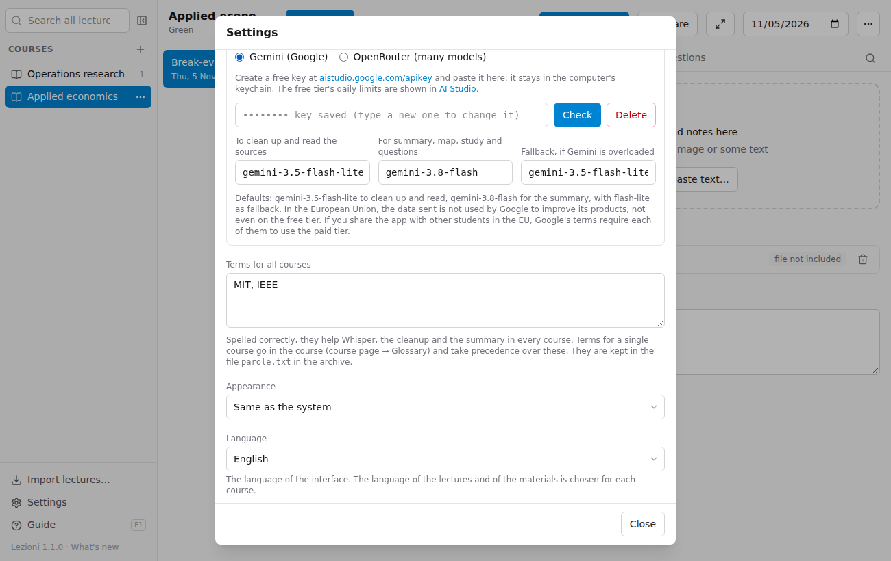
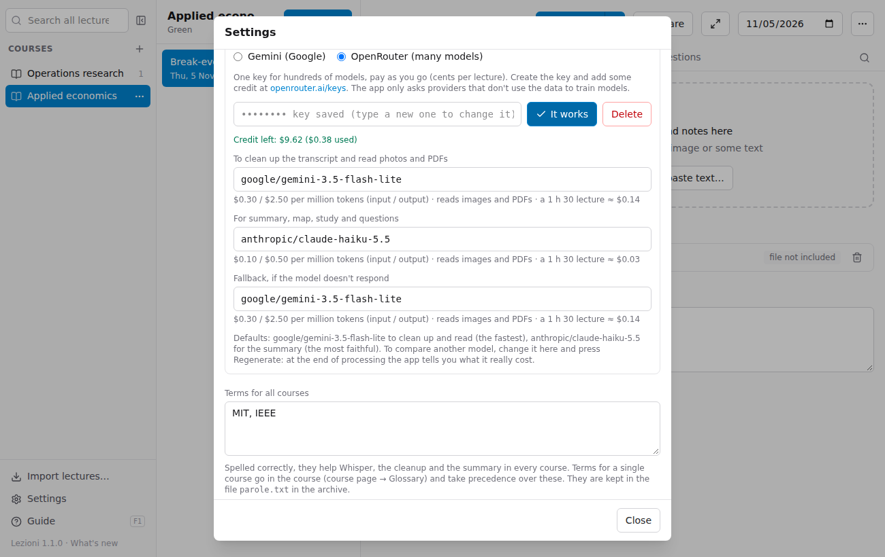
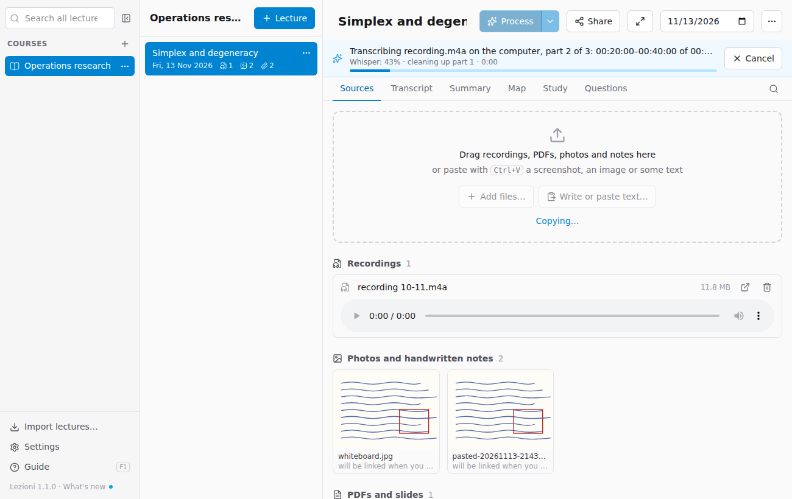

# Processing lectures

**Recordings** are transcribed on your computer with **Whisper**, free and without limits: the audio never leaves the computer. An **AI service** then cleans up the transcript, reads photos and PDFs and writes the summary, map and study material. You choose the service in Settings:

- **Gemini** (Google): it has a free tier, but at peak times Google often turns requests down ("overloaded");
- **OpenRouter**: a single key for hundreds of models (Google, Anthropic, OpenAI, DeepSeek…), paid as you go. With transcription on the computer a lecture costs a few cents, and at the end of processing the app tells you what it really cost.

## With Gemini (once only)

1. Go to [aistudio.google.com/apikey](https://aistudio.google.com/apikey) with your Google account and create a key (it is free).
2. In Lezioni open **Settings**, choose **Gemini (Google)**, paste the key and press **Check and save**.

The default **models** are `gemini-3.5-flash-lite` for cleaning up the transcript and reading the sources (fast, and available even when the other one is overloaded) and `gemini-3.8-flash` for the summary, map, study material and questions. The **fallback model** (by default `gemini-3.5-flash-lite`) is used for a request when Google replies twice in a row that the first one is overloaded; the app tells you at the end. Leave it empty to always retry with the same model.

## With OpenRouter (once only)

1. Create an account on [openrouter.ai](https://openrouter.ai), add some credit (a few euros/dollars are enough for many lectures) and create a key at [openrouter.ai/keys](https://openrouter.ai/keys).
2. In Lezioni open **Settings**, choose **OpenRouter**, paste the key and press **Check and save**: the app shows the credit left.

For each model the app shows the price, whether it reads images and PDFs and roughly what a 1 h 30 lecture would cost. The defaults are `google/gemini-3.5-flash-lite` for cleaning up and reading (the fastest) and `anthropic/claude-haiku-5.5` for the summary (the most faithful to what was said), with flash-lite as fallback. The field suggests every model in the price list: type part of the name to search for them.

- The model for **cleaning up and reading** must read images, otherwise photos and handwritten notes are skipped: the app warns you.
- To **compare** two models, change the summary model and press **Regenerate**: the previous version stays in `generati/versioni`, and the final notification tells you what the new one cost.
- The app only asks OpenRouter for providers that **don't use the data** to train models.
- With OpenRouter, recordings are always transcribed on the computer.

The key, for Gemini or OpenRouter, stays in the computer's **keychain** (Keychain on Mac, Credential Manager on Windows), not in the archive files.

## Processing a lecture

Press **Process** at the top of the lecture. A bar shows how far it has got:

1. each **recording** is split into 20-minute parts and transcribed on the computer by Whisper, one part at a time. While Whisper works on the next part, the chosen model cleans up the one already done: it removes fillers and repetitions, fixes misrecognised words, splits the text into paragraphs with headings, writes formulas in LaTeX and marks students' questions and comments, keeping the timestamps;
2. **photos and PDFs** are read, including formulas and descriptions of charts and diagrams. Recordings always come first, even if you added them later: in references the recording is usually **F1**;
3. from **all the sources together**, plus your notes, the summary, map, flashcards, exam questions and glossary are written.

Below the bar, a second line says what it is waiting for (Whisper's progress, the model's answer, a new attempt if the service is busy) and for how long. You can keep using the app while it works, even on other lectures; **Cancel** stops it.

### Transcription on the computer

- The first time, the app downloads the **transcription model** (574 MB, once only). You can download it beforehand from **Settings → Transcription of the recordings → Download now**: the download carries on even if you close Settings, and when you reopen them you see how far it has got (or cancel it).
- On a Mac with Apple silicon (M1 and later) it is fast: about 1 minute for every 10 minutes of lecture. On older computers or without a graphics card it can take as long as the recording itself.
- If the model cannot clean up a part (for example because the service is overloaded), Whisper's text is kept, already with its timestamps, and the app tells you: the cleanup is retried at the next processing.
- With Gemini as the service you can choose transcription **With Gemini** instead: the audio is sent to Google, which also recognises who is speaking, but it uses a lot of quota and on the free tier it is sometimes overloaded.

## Processing again

- **Regenerate** redoes the summary, map and study material **reusing the transcripts already made**: it costs little. Useful after adding notes or slides, after [correcting a transcript](05-studiare.md#correcting-the-transcript), or to try another model.
- From the arrow next to it: **Process the sources again too** also redoes transcripts and readings. If you have corrected some transcripts by hand, the app asks for confirmation, and the corrected version stays in `estratti/versioni`.
- Earlier versions of the summary and map stay in `generati/versioni` in the lecture folder.

If processing is interrupted (connection, quota used up), the parts of the recording already transcribed are saved: next time it starts again from there. In that case the summary is not written, so as not to make one without the recording.

## Costs and limits

- **Gemini, free tier**: you pay nothing, but there is a daily limit on requests (you can see it in [AI Studio](https://aistudio.google.com/rate-limit)) and at peak times requests are often turned down.
- **Gemini with billing** enabled on Google: a few cents per lecture with transcription on the computer; with transcription **With Gemini** about $0.30–0.40 with `gemini-3.8-flash`. At the end of processing the app shows the tokens used and what they would have cost.
- **OpenRouter**: pay as you go, from the credit you added. With the default models a 1 h 30 lecture costs a few cents; at the end of processing the app shows the **real cost**.

## Privacy

With transcription on the computer the audio stays on the computer; the chosen service receives the transcribed text, photos, PDFs and notes. With transcription **With Gemini** the audio is sent too. For users in the European Union, Google does not use this data to improve its products, not even on the free tier; with OpenRouter the app excludes providers that would use it. All the same, avoid including sensitive personal data.
