# Studying: transcript, summary, map, study

## Transcript

The **Transcript** tab shows the text of each source: the transcribed recordings and the content read from photos and PDFs. The text is cleaned of fillers and repetitions, split into paragraphs, with headings when the topic changes and formulas written as formulas.

Each paragraph starts with the **minute** it begins at: click it and the recording plays from there.

If the lecture has several documents (recording, slides, photos), at the top there is the **In this lecture** row with a label for each one: click it to go there. As you scroll, the document name at the top opens the list of the others, and the ↑ ↓ arrows next to it take you to the previous and the next one.

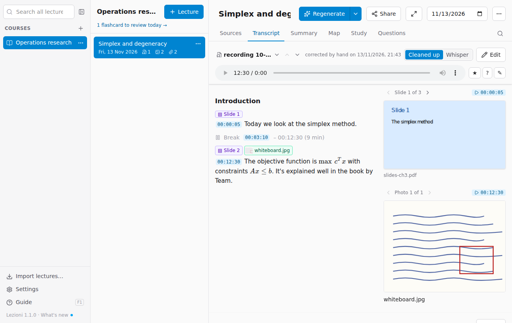

### Bookmarks while you listen

While listening to a recording again, you can mark the points that matter with the three buttons next to the player:

- **★ Important** (key **I**): a point to remember.
- **? Didn't understand** (key **D**): a passage to clear up.
- **✎ Note** (key **N**): a point with a note of your own, for example "ask during office hours".

The bookmark takes the minute you have reached. The keys work for the recording you are listening to, when you are not typing in a text field. In the transcript, the paragraph at that minute is highlighted with the icon. Above the text, the **N bookmarks** row opens the list: click the minute to listen again, the text to write or change the note, the bin to delete it.

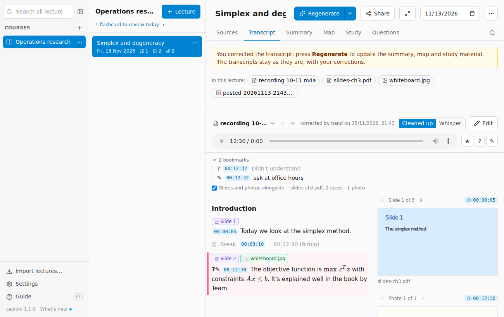

With **Regenerate**, the summary gives more room to the important points and explains the ones you didn't understand more carefully. **Questions** know about them too: you can ask "explain the points I didn't understand". Bookmarks are kept in the lecture's `segnaposti.json` file and travel in packages, like notes.

### Slides alongside the transcript

If the lecture has the **lecturer's slides** linked to the recording (see [Sources](03-fonti.md#lecture-slides-or-other-material)), the **current slide** appears next to the transcript:

- while you listen, the slide changes by itself when the lecturer moves to the next one;
- when you scroll, it follows the text you are reading (the paragraph a third of the way down the screen), even while the audio is playing; if you then stop scrolling, it goes back to following the audio;
- **‹ ›** page through the slides; **▶ 00:12:30** above the slide plays from when the lecturer gets to it;
- in the text, the **▤ Slide 12** label marks where the lecturer moves to that slide: click it to see it;
- in the text of the slides, next to each **Page N** is the minute at which it is discussed.

The **Slides alongside** checkbox hides or shows it again. With the course and lecture columns open there is little room: **full screen** is the most comfortable way to study like this.

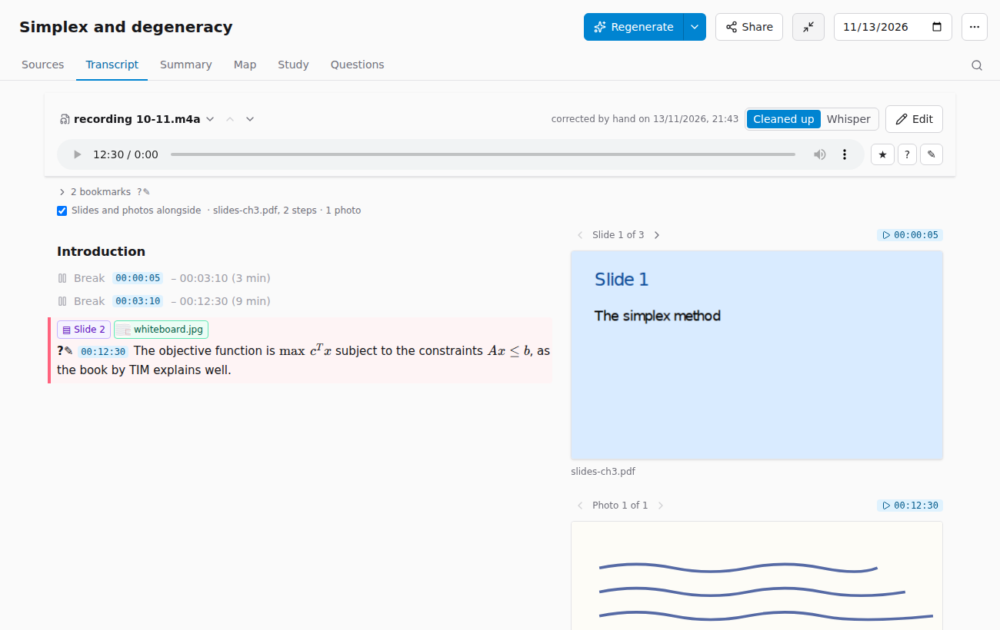

### Photos alongside the transcript

Photos linked to the recording (see [Sources](03-fonti.md#photos-linked-to-the-recording)) appear in the transcript:

- at the start of the paragraph where the lecturer talks about it there is a green label with the photo's **thumbnail** and title: click it to see it next to the text;
- next to the transcript, below the slide if there are slides too, is the **current photo**: like the slide, it follows the audio and the text you are reading; **‹ ›** page through the photos, **▶** plays from that point, and clicking the photo opens it full screen with the system's app.

The checkbox above the text (**Photos alongside**, or **Slides and photos alongside**) hides or shows the panel again.

### Linking a photo by hand

When you hover over a paragraph of the transcript, a photo icon with a **+** appears at the top right. Click it: the list of the lecture's photos opens, with the thumbnail and where each one is linked now. Choose the photo and it is linked to that paragraph's minute. If you are listening to the recording, at the top you can choose **Playing 00:13:05** to link it to the exact point you are hearing instead of the start of the paragraph.

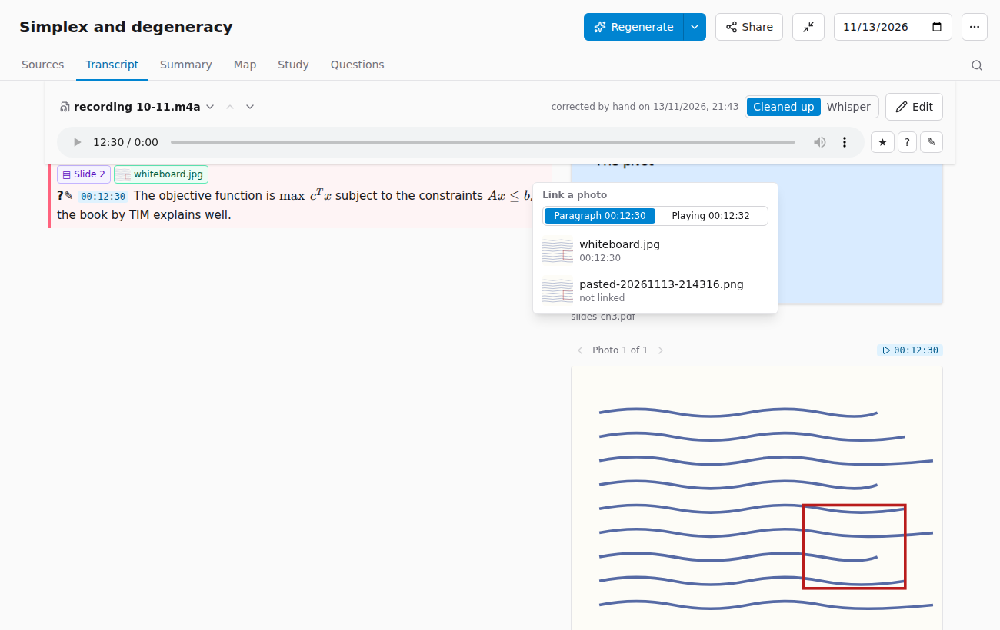

To move or unlink it, use its card in Sources.

### Breaks

If the recording kept running during a break or a silence, Whisper tends to fill the gap with made-up words (typically "grazie grazie grazie…" [thank you thank you…], or "sottotitoli a cura di…" [subtitles by…]). The app recognises them and replaces them with a single grey line: **Break 00:12:23 – 00:16:19 (4 min)**, with a clickable timestamp. The made-up text doesn't reach the model, so it doesn't pollute the summary and the questions.

- In lectures processed before this version, if there are breaks to fix, the **N breaks to fix** button appears in the recording's header: one click and they become break lines.
- By hand: in **Edit**, select the paragraphs to skip (a few words are enough, the whole paragraph counts) and press **Mark as break**, then **Save**. Also useful for off-topic chat or for a piece you don't need.

### Whisper's text

For recordings transcribed on the computer, the **Cleaned up | Whisper** switch shows the text as Whisper recognised it, before the model cleaned it up. It helps you check a doubtful passage: if the cleaned-up version says something odd, Whisper's text shows what was actually heard (and the minute to listen to it again).

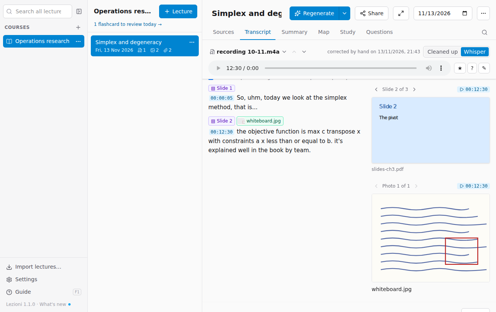

### Correcting the transcript

**Edit** opens the text of a source to correct it by hand: it is Markdown, with the timestamps in square brackets at the start of paragraphs (leave them as they are, they are needed for the references). At the top, **Find** and **Replace all** fix a wrong word throughout the text in one go, ignoring upper and lower case.

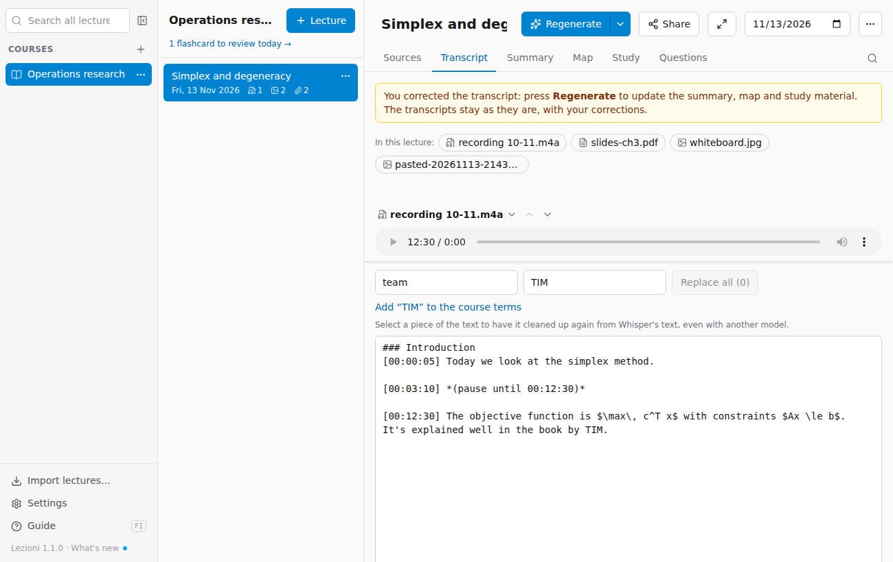

- After a replacement you can **add the word to the course terms** (see [Courses](02-archivio.md#courses)): that way the next lectures already recognise it correctly.
- **Save** keeps the correction; the source shows "corrected by hand". The correction applies to search, questions, exports and packages.
- The summary, map and study material don't change by themselves: press **Regenerate** to redo them with the corrected text (the app reminds you with a notice). Regenerate redoes **only** the summary, map and study material: the transcripts and the texts read stay as they are, with your corrections, and it costs about a cent. It is up to you whether the correction is worth a new summary: for a single word it often isn't.
- **Cleaning up a piece again**: if a passage came out badly, select it in the text (a few words are enough: the whole paragraph counts) and press **Clean up the selection again**. The model redoes the cleanup of those paragraphs starting from Whisper's text; you can choose another model from the drop-down. You see the current text and the proposal side by side and choose **Replace** or **Keep as it was**; then **Save** as with any correction. It costs a fraction of a cent and needs Whisper's text (lectures processed before this version only have it after *Process the sources again too*).

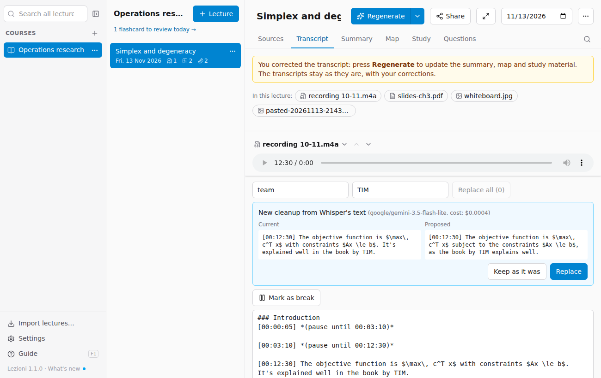

- **Process the sources again too** redoes the transcription from scratch: the app asks for confirmation and keeps the corrected version in `estratti/versioni` in the lecture folder.

## Find in the lecture

The magnifying glass to the right of the tabs (or **⌘F** on Mac, **Ctrl+F** on Windows) searches the open tab: transcript, summary, study… All matches are highlighted in yellow, the current one in orange; **Enter** goes to the next one, **Shift+Enter** to the previous one, **Esc** closes. Upper case and accents don't matter. To search all lectures, use the field at the top left.

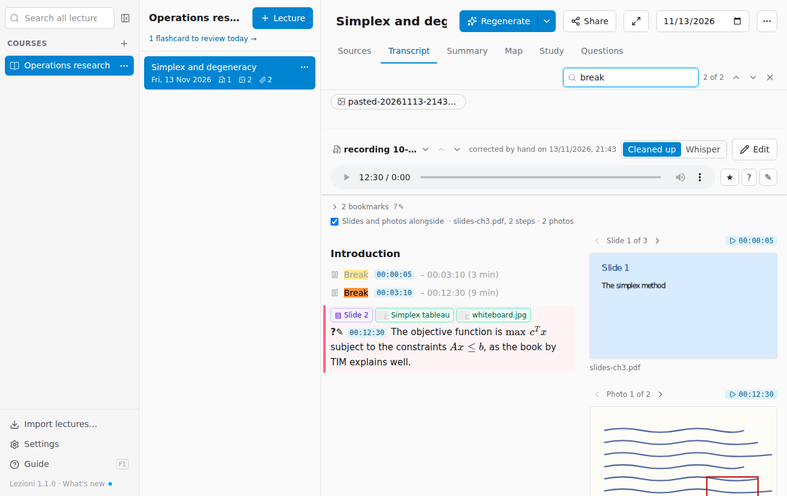

## Summary

The **Summary** brings all the sources together into a well-ordered text, with headings, lists, tables, formulas and examples. At the end of each paragraph are the **references**: **F1 00:12:30** means "source 1, at minute 12:30". Clicking it opens the transcript with the recording already at that point: handy for listening again to an unclear passage. For PDFs the reference can give the page, like **F2 p. 3**: clicking it opens that source. Photos linked to the recording can appear in the summary, with their title below, where they help understanding (a diagram, an exercise on the whiteboard): after linking new ones, press **Regenerate**. They also appear in the HTML, PDF and Markdown exports.

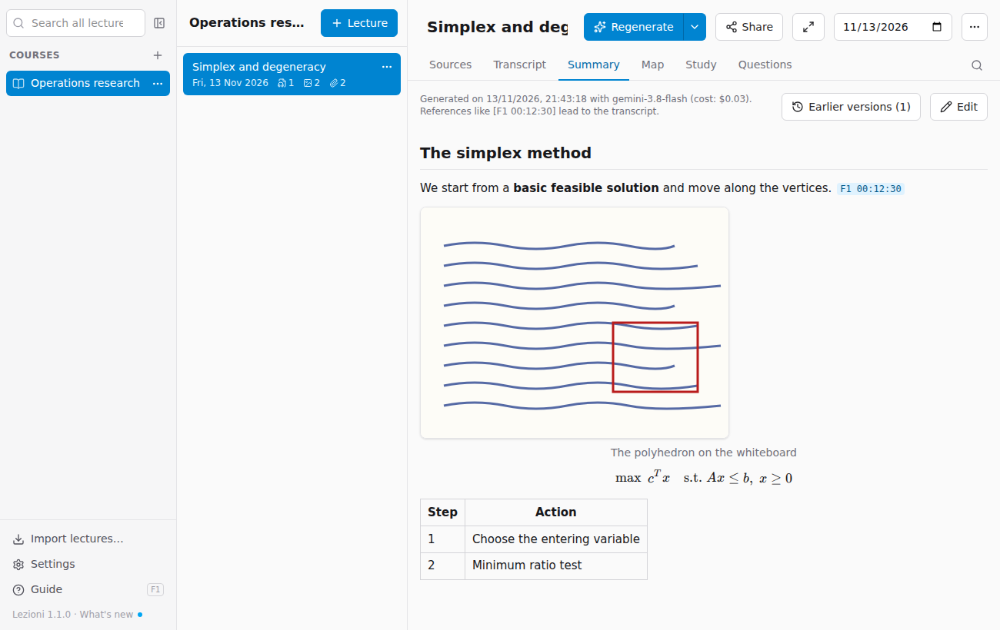

The summary can also be corrected with **Edit**, with the same find and replace. With **Regenerate** the corrected version is not lost: it stays in `generati/versioni`.

### Earlier versions

Every time you press **Regenerate**, the previous summary, map and study material become an **earlier version**. The same goes for a transcript corrected by hand and then redone with *Process the sources again too*. The **Earlier versions** button (in the Summary, and next to each transcript that has some) opens the list by date:

- **Differences** compares the version with the current one line by line: in red what was there then, in green what is there now. **Text** shows it in full.
- **Restore this version** makes it the current one again. For the summary, the map and study material of that version come back with it. The one you replace is not lost: it becomes an earlier version in turn.

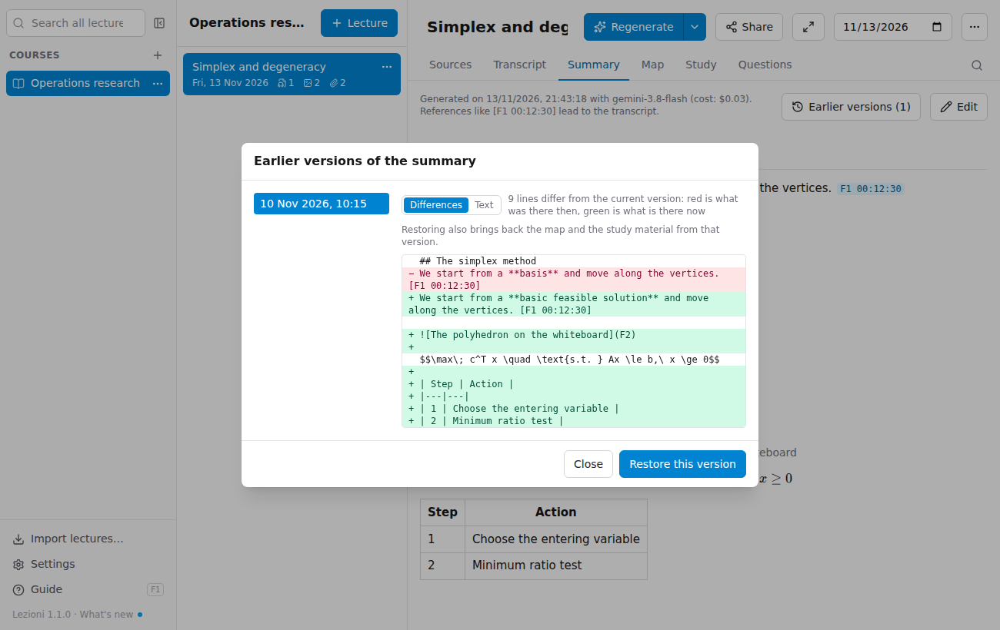

## Map

The **Map** shows the topics of the lecture as a tree: the main topic in the centre, then the concepts and sub-concepts. Click a concept to collapse or expand its branches.

- The **arrow** next to a concept takes you to the point in the transcript where it is discussed, with the recording already there (or to the source, for slides and notes). Maps made from this version on have the reference for every concept; for older ones the app looks for it in the summary, so the arrow may be missing on some concepts: with **Regenerate** it appears everywhere.
- **Export to PDF** opens the map on its own, drawn as in the app on a landscape page: in the print dialog choose "Save as PDF".

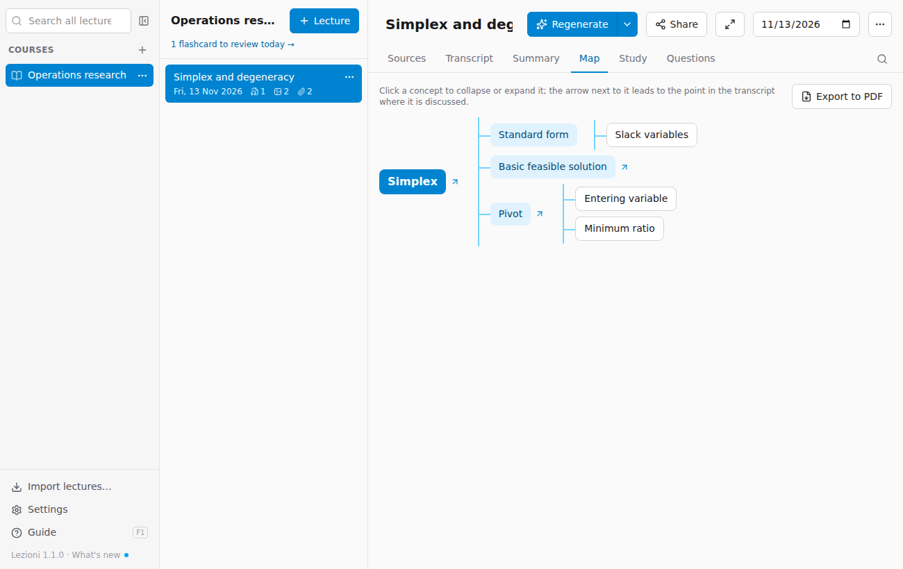

## Study

- **Flashcards**: in **Browse**, click the card to see the answer, then *Next*; **Shuffle** changes the order. In **Review** you only see the cards due today (see below).
- **Exam questions**: questions like those in the exam; click a question to see the answer outline.
- **Glossary**: the technical terms of the lecture, in alphabetical order.

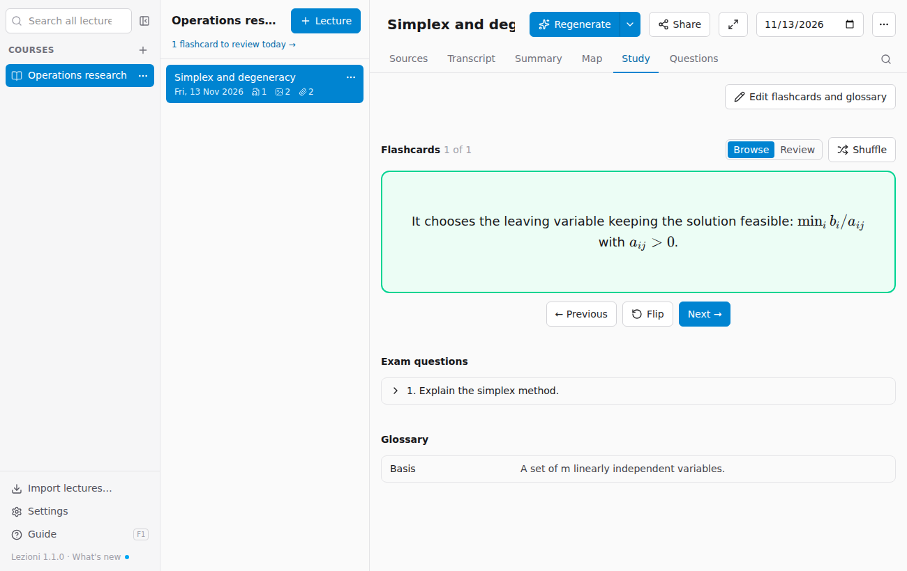

### Spaced review

In **Review** the app offers you the flashcards due today. Think of the answer, press **Show the answer** and then say how it went:

- **Knew it**: the card comes back in 1 day, then in 3, 7, 14 and 30 if you keep knowing it.
- **Didn't know it**: the card goes to the end of today's session and the count starts again from scratch.

Cards you have never seen come in at most **20 at a time**, so a whole course doesn't start with hundreds of cards; when the session is over, *More new cards* offers more. The same review, with the cards from **all the lectures** of the course, is on the **course page** (click the course name above the lectures), and below the course name you see how many cards are due today. Each card shows the lecture it comes from.

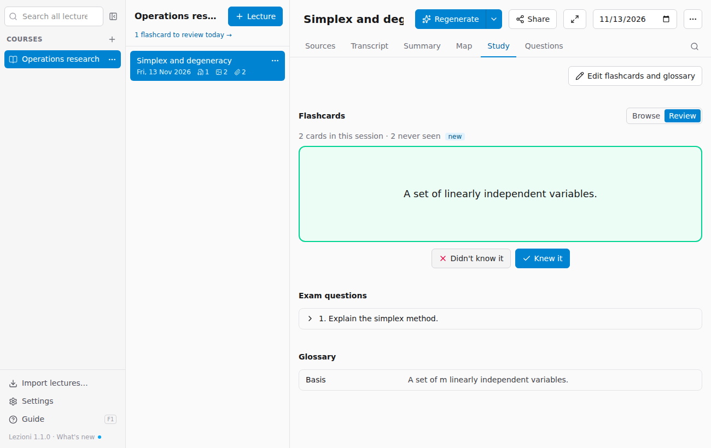

With *Regenerate*, cards that stay the same (same question) keep their place in the review. Progress is kept in the lecture's `ripasso.json` file and is not included in the packages you share.

**Edit flashcards and glossary** turns flashcards, exam questions and glossary into a list of fields: correct the text, delete wrong entries with the bin or add your own with **Add**, then **Save**. Entries left empty are not saved.

> The material is written by artificial intelligence from your sources: it is a study aid, not a substitute. If something doesn't add up, check the transcript or listen again to the point indicated.
