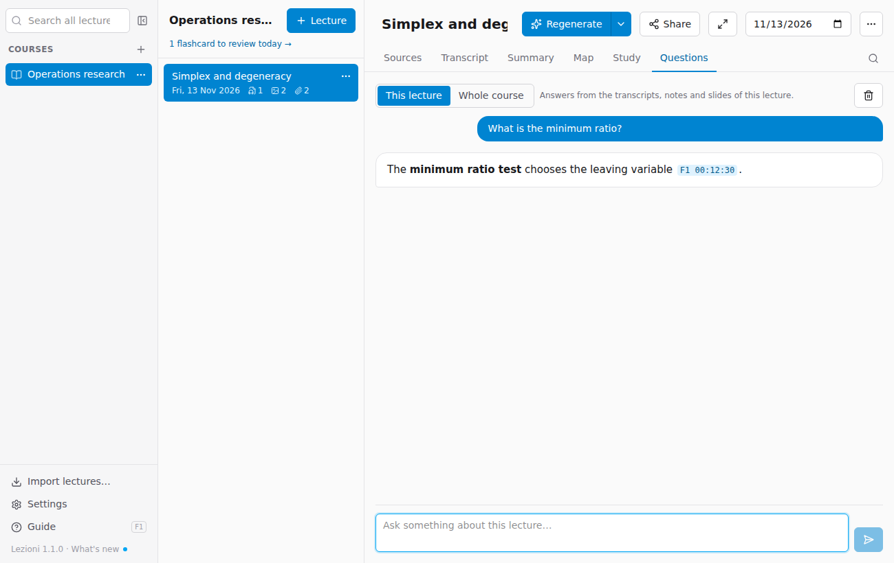

# Questions about the lecture or the course

The **Questions** tab is a chat where you can ask for explanations, examples or connections. The answers come **only from your material** and cite the sources.

At the top, choose where to look for the answer:

- **This lecture**: Gemini reads the lecture's transcripts, notes and slides. In the references, **F1 00:12:30** reopens the recording at that minute.
- **Whole course**: Gemini reads the **summaries** of all the lectures of the course (not the full transcripts, which would be too long and expensive). References like **L3** open the lecture cited.

For **Whole course**, the lectures must already have been processed.

Tips:

- ask precise things: "Explain the step from the initial tableau to the first iteration", "Give me a numerical example of the minimum ratio test";
- you can ask follow-up questions: the chat remembers the previous ones;
- if the answer is not in the sources, the chat says so; a general explanation is flagged as "(not from the sources)".

Enter sends the question, **Shift+Enter** starts a new line. The bin deletes the conversation shown.

Conversations stay in the lecture folder (`chat.json`) and are **never included** when you share the lecture.
