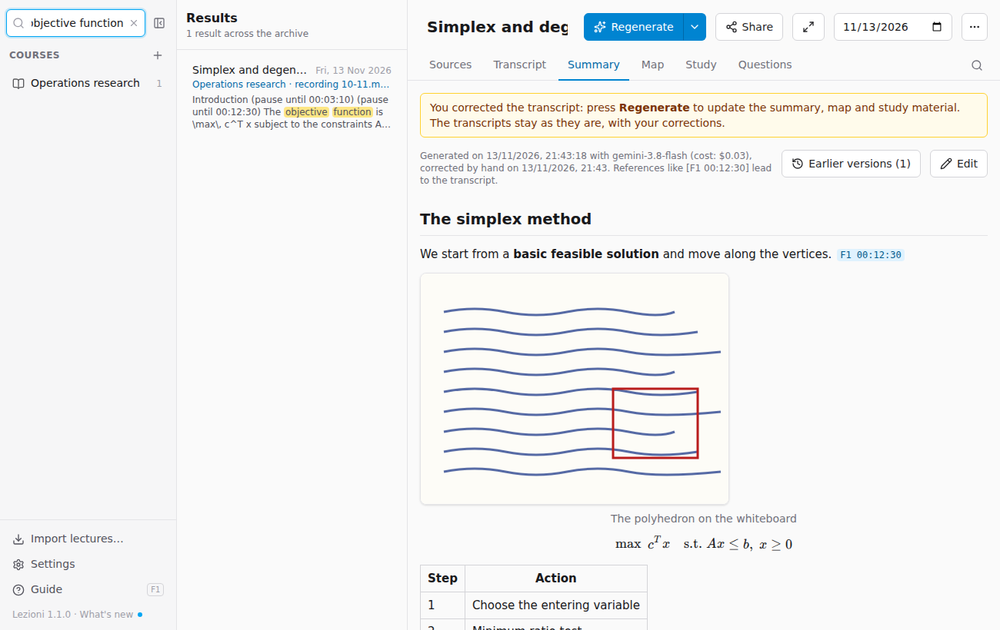

# Searching the archive

The **Search all lectures** field, at the top left, searches the whole archive: titles, notes, transcripts, texts read from photos and PDFs, summaries, flashcards and glossaries.

- Accents and upper case don't matter: *citta* finds *città*.
- With several words, each result contains all of them (even if not next to each other).
- Each result says which **course**, **lecture** and **part** it is in (for example the recording and the minute) and shows the surrounding text, with the words highlighted.
- Clicking a result opens the lecture in the right tab; for a transcript, the recording is already at the minute found.

**Esc** or the **×** clear the search and take you back to the list of courses.
