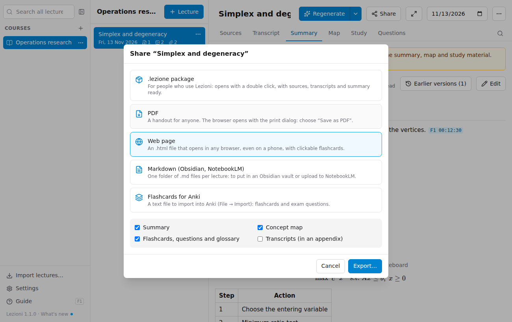
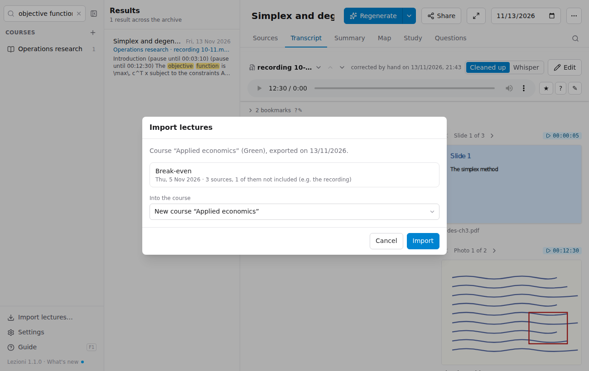

# Sharing with classmates

**Share…**, at the top of the lecture, exports the lecture; **Export the course** (when you hover over the course) exports all the lectures of a course. You can send the files created however you like: WhatsApp, email, Google Drive.

| Format | For whom | What it contains |
|---|---|---|
| **.lezione package** | People who use Lezioni | The complete lecture: sources, transcripts, summary, map, study material. It opens with a double-click and doesn't need processing again |
| **PDF** | Anyone | A handout with summary, map (drawn as in the app), flashcards, questions and glossary, and optionally the transcripts in an appendix. The map alone can also be exported to PDF from the Map tab |
| **Web page** | Anyone | The same content in an `.html` file that opens in any browser, even on a phone and offline, with clickable flashcards |
| **Markdown** | People who use Obsidian or NotebookLM | One folder per lecture with Summary, Map, Study and Transcripts as `.md` files |
| **Flashcards for Anki** | People who review with Anki | A text file to import into Anki with *File → Import* |

## .lezione package: what is included

- **Recordings**: excluded by default, because they are large and you need the lecturer's permission to share them. Their **transcript is included anyway**: whoever receives the package sees the source as "file not included", but has the text.
- **Photos, PDFs and notes**: included by default.
- **Your notes on the lecture**: excluded, unless you choose to include them.
- **The conversations in the Questions tab**: never included.

## PDF

Choosing **PDF** opens the browser with the print dialog: as the printer, choose **Save as PDF** (on Mac at the bottom left, on Windows "Microsoft Print to PDF"). Flashcards appear already turned over, with the answer.

## Importing a package you received

Double-click the `.lezione` file, or drag it into the window, or use **Import lectures…** at the bottom left.

The window shows the lectures it contains and suggests the course with the same name (or creates a new one). If a lecture is already in your archive you can:

- **leave it as it is** and import only the new ones;
- **replace it** with the one you received (yours goes to the Trash);
- **keep both**, as two separate lectures.
