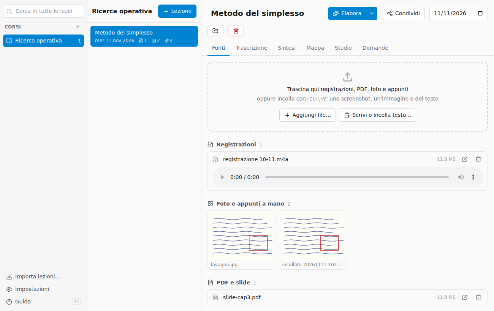
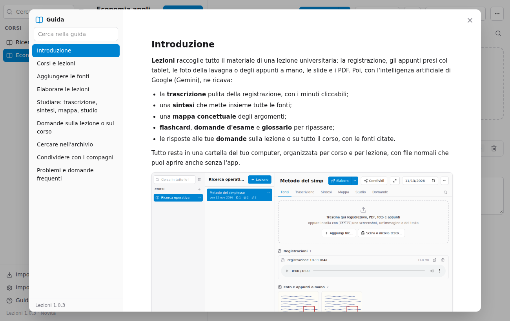
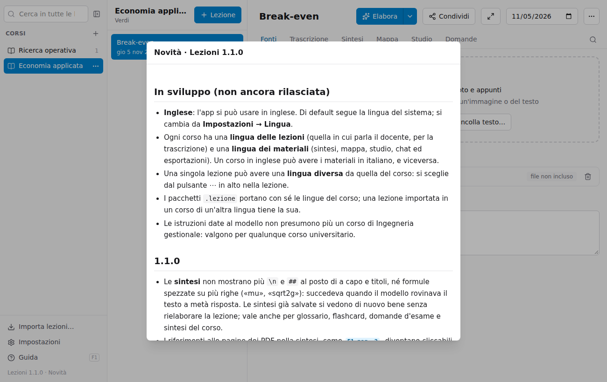

# Introduzione

**Lezioni** raccoglie tutto il materiale di una lezione universitaria: la registrazione, gli appunti presi col tablet, le foto della lavagna o degli appunti a mano, le slide e i PDF. Poi, con l'intelligenza artificiale di Google (Gemini), ne ricava:

- la **trascrizione** pulita della registrazione, con i minuti cliccabili;
- una **sintesi** che mette insieme tutte le fonti;
- una **mappa concettuale** degli argomenti;
- **flashcard**, **domande d'esame** e **glossario** per ripassare;
- le risposte alle tue **domande** sulla lezione o su tutto il corso, con le fonti citate.

Tutto resta in una cartella del tuo computer, organizzata per corso e per lezione, con file normali che puoi aprire anche senza l'app.

## Come è fatta la finestra

- **A sinistra**: la ricerca, l'elenco dei **corsi** e, in basso, *Importa lezioni*, *Impostazioni* e questa *Guida*.
- **Al centro**: le **lezioni** del corso scelto, dalla più recente.
- **A destra**: la lezione aperta, con le schede **Fonti**, **Trascrizione**, **Sintesi**, **Mappa**, **Studio** e **Domande**.

Le colonne si allargano o si stringono trascinandone il bordo; un doppio clic sul bordo le riporta alla misura iniziale.

## Il percorso tipico

1. Crea il corso e la lezione ([Corsi e lezioni](02-archivio.md)).
2. Trascina dentro registrazione, appunti e slide ([Aggiungere le fonti](03-fonti.md)).
3. Premi **Elabora** ([Elaborare le lezioni](04-elaborare.md)).
4. Studia dalle schede Sintesi, Mappa e Studio ([Studiare](05-studiare.md)) e fai domande ([Domande](06-domande.md)).
5. Condividi la lezione con i compagni ([Condividere](08-condividere.md)).

Questa guida si apre in qualsiasi momento con **F1** o con **Guida** in basso a sinistra. A sinistra c'è l'indice, con una ricerca nel testo della guida.

Sotto la Guida c'è la **versione** dell'app (per esempio *Lezioni 1.1.0 · Novità*): cliccala per leggere le novità di ogni versione. Un pallino blu accanto vuol dire che l'app è stata aggiornata e ci sono novità che non hai ancora letto.

