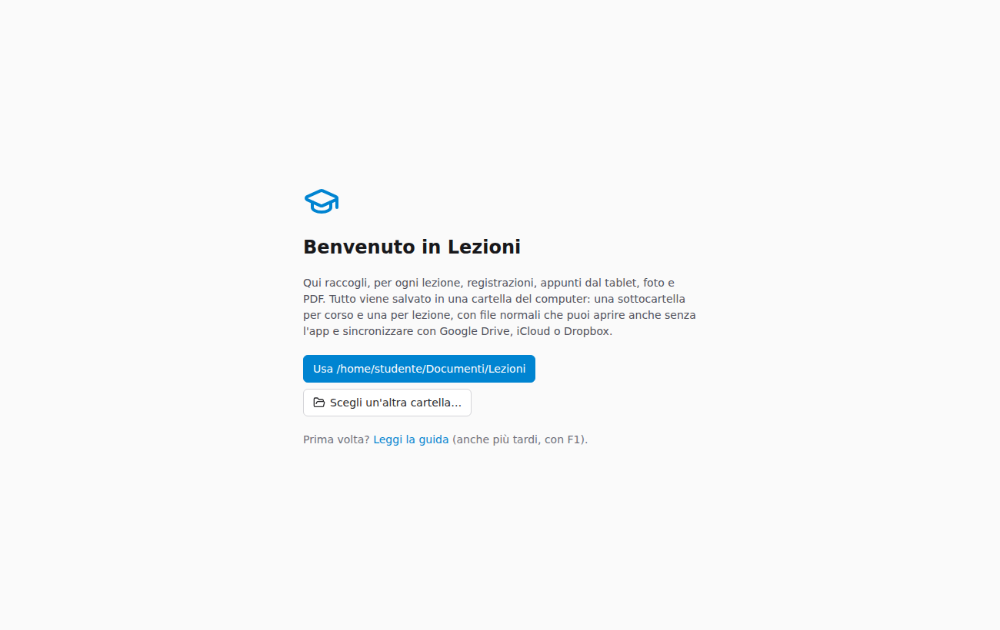
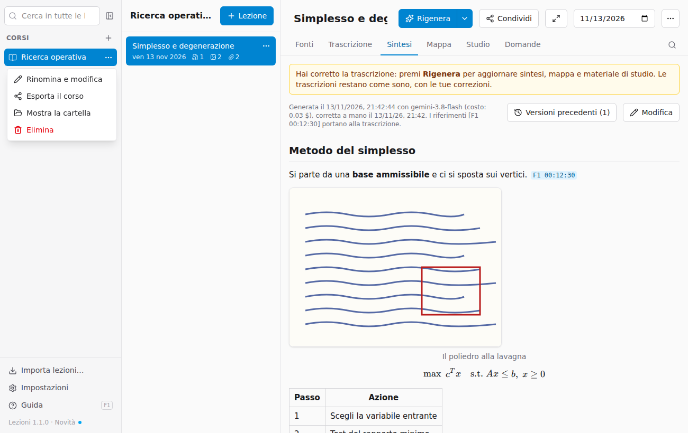
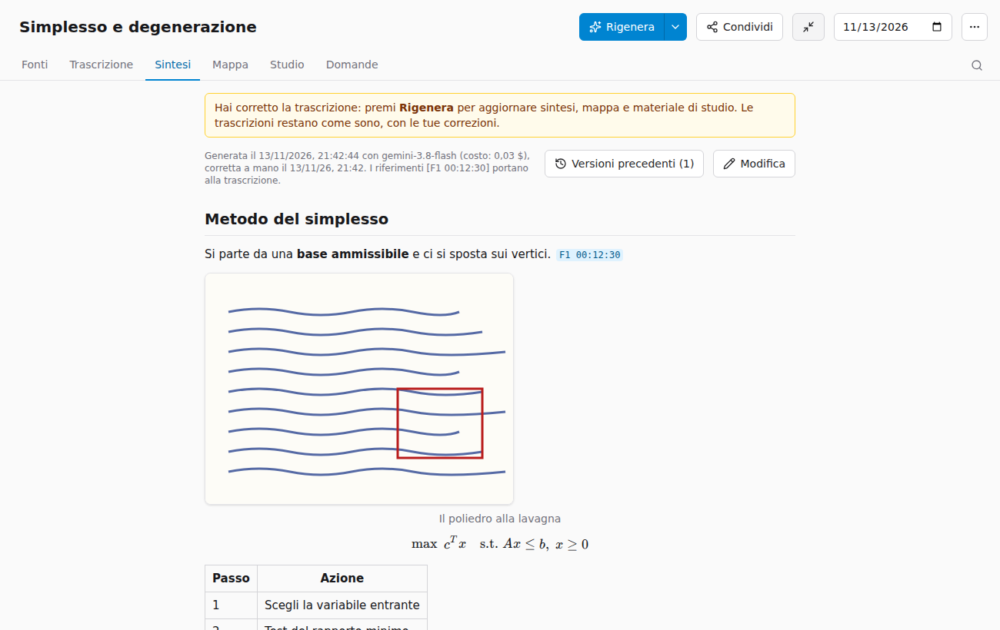
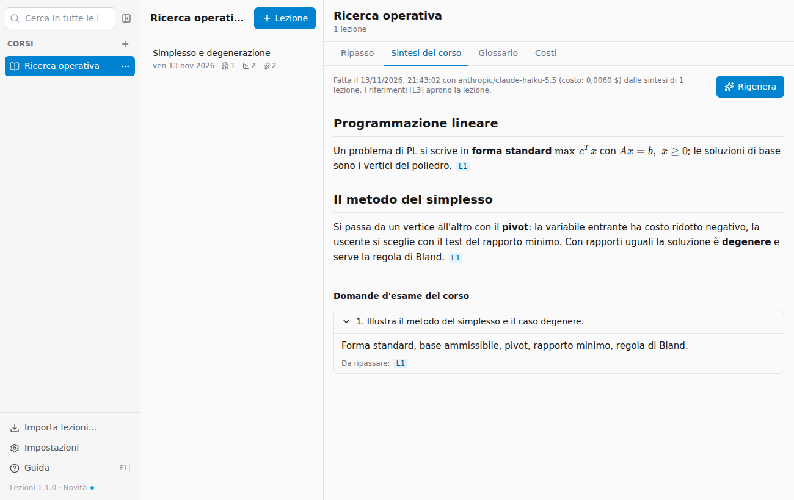
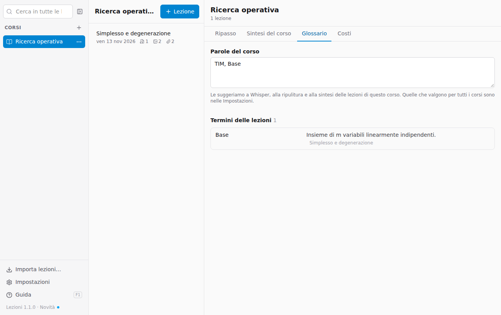
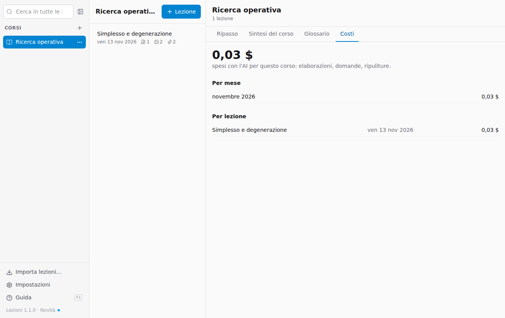

# Corsi e lezioni

## Prima apertura: la cartella dell'archivio

Alla prima apertura l'app chiede dove tenere l'archivio. La proposta è la cartella **Documenti/Lezioni**; puoi sceglierne un'altra, anche dentro Google Drive, iCloud Drive o Dropbox, così l'archivio si sincronizza da solo e ne hai sempre una copia.



L'archivio è fatto di cartelle normali:

```
Lezioni/
  Ricerca operativa/
    2026-11-10 Metodo del simplesso/
      fonti/       i file che hai aggiunto
      estratti/    il testo letto da ogni fonte (trascrizioni, appunti), il testo
                   di Whisper (.whisper.md) e le copie delle correzioni (versioni/)
      generati/    sintesi, mappa, flashcard
    generati/      sintesi del corso
```

Puoi aprire questi file anche senza l'app. La cartella si cambia da **Impostazioni**: per spostare l'archivio, sposta la cartella e poi sceglila lì.

## Corsi

- **Nuovo corso**: il **+** accanto a *Corsi*. Il docente è facoltativo.
- **Parole del corso**: nella pagina del corso, scheda **Glossario** (oppure ⋯ → *Rinomina e modifica*), puoi scrivere i termini tecnici e i nomi che tornano spesso, separati da virgole e scritti giusti: per esempio `ARERA, colpo d'ariete, cassa d'aria, Gauckler-Strickler`. Vengono suggeriti a Whisper, alla ripulitura e alla sintesi, così sbagliano meno; valgono dalle elaborazioni successive. Puoi aggiungerne una anche mentre correggi una trascrizione.
- **Parole per tutti i corsi**: nomi e sigle che tornano in più corsi (il nome dell'università, enti, docenti) si scrivono una volta sola in **Impostazioni → Parole per tutti i corsi**. Valgono per ogni corso, dopo le sue parole. Stanno nel file `parole.txt` dell'archivio, quindi seguono l'archivio se lo sincronizzi.
- Il pulsante **⋯** accanto al corso (sempre visibile su quello scelto, sugli altri al passaggio del mouse) apre il menu con **Rinomina e modifica**, **Esporta il corso**, **Mostra la cartella** ed **Elimina**.



- Il pulsante accanto al campo di ricerca **nasconde la colonna dei corsi** per lasciare più spazio; lo stesso pulsante in cima all'elenco delle lezioni la fa ricomparire. La ricerca in tutte le lezioni sta in quella colonna.
- Cliccando il **nome del corso** in cima all'elenco delle lezioni si apre la **pagina del corso** (vedi sotto). Si apre anche quando scegli un corso e nessuna lezione.
- Eliminare un corso lo sposta nel **Cestino** con tutte le sue lezioni: si può recuperare da lì.

## Lingue

Lezioni funziona in **italiano** e in **inglese**, e tiene separate tre lingue:

- **La lingua dell'app** (menu, pulsanti, messaggi): **Impostazioni → Lingua**. Di default è quella del sistema: italiano se il computer è in italiano, inglese altrimenti.
- **La lingua delle lezioni**: quella in cui parla il docente. Si sceglie per ogni corso, nella finestra del corso (**+** accanto a *Corsi*, oppure ⋯ → *Rinomina e modifica*). Serve alla trascrizione: Whisper sente meglio se sa in che lingua ascoltare, e la ripulitura non traduce mai. Se una lezione è in un'altra lingua (un ospite, un seminario in inglese in un corso italiano), cambiala dal pulsante **⋯** in alto nella lezione, sotto *Lingua parlata nella lezione*: *Lingua del corso*, *Italiano* o *Inglese*.
- **La lingua dei materiali**: quella in cui vengono scritti sintesi, mappa, glossario, flashcard, domande d'esame, sintesi del corso e risposte della chat. Si sceglie per ogni corso, accanto alla lingua delle lezioni. Per esempio un corso in inglese con i materiali in italiano: la trascrizione resta in inglese, la sintesi è in italiano e la prima volta riporta tra parentesi i termini tecnici originali.

Un corso nuovo prende per entrambe la lingua dell'app; i corsi fatti prima della versione 1.2 sono in italiano. Foto e PDF vengono letti nella lingua in cui sono scritti, qualunque sia quella del corso. Le esportazioni (pagina web, PDF, Markdown, Anki) usano la lingua dei materiali.

Cambiare la lingua di un corso o di una lezione non rifà niente da solo: per trascrivere di nuovo usa **Rielabora anche le fonti**, per riscrivere solo i materiali nella nuova lingua **Rigenera** (vedi [Rielaborare](04-elaborare.md#rielaborare)).

## Lezioni

- **+ Lezione** in alto nell'elenco: titolo (puoi cambiarlo dopo) e data, che di default è oggi.
- Il **titolo** si modifica cliccandoci sopra nella pagina della lezione, la **data** dal campo accanto. Il nome della cartella segue titolo e data.
- Nell'elenco, accanto alla data, le icone contano registrazioni, foto e altri file.
- Con più di sei lezioni compare un campo per filtrarle.
- Il pulsante **⋯** accanto a una lezione nell'elenco (o in alto nella lezione aperta) ha **Condividi…**, **Mostra la cartella** ed **Elimina** (va nel Cestino, da cui si recupera).
- Il pulsante **Tutto schermo** in alto nella lezione (le due frecce) nasconde corsi e lezioni e lascia tutta la finestra alla lezione aperta; **Esc** o lo stesso pulsante tornano indietro. Per avere anche la finestra a schermo intero c'è il pulsante verde della finestra del Mac.



- In fondo alla scheda **Fonti** ci sono le **note sulla lezione**: argomenti, cose da rivedere, compiti. Vengono usate anche per la sintesi.

## La pagina del corso

Raccoglie quello che riguarda il corso intero.

### Ripasso

Le flashcard di tutte le lezioni del corso da ripassare oggi, come il ripasso di una lezione (vedi [Studio](05-studiare.md#ripasso-a-intervalli)). Sopra ogni carta c'è la lezione da cui viene: cliccala per aprirla.

### Sintesi del corso

Una sintesi di **tutto il corso** per preparare l'esame, fatta dalle sintesi delle lezioni: è organizzata per argomenti, non lezione per lezione, e collega quello che è stato spiegato in giorni diversi. Sotto ci sono le **domande d'esame del corso**: quelle proposte per le singole lezioni, unite e scelte fra le più ricorrenti, ognuna con la traccia di risposta e le lezioni da ripassare.

- **Genera la sintesi del corso** la crea (serve almeno una lezione elaborata); poi **Rigenera** la rifà, e la precedente resta in `generati/versioni` nella cartella del corso.
- I riferimenti **L1**, **L2**… indicano le lezioni da cui viene ogni paragrafo, dalla più vecchia: cliccandoli apri la lezione.
- Quando aggiungi o rielabori lezioni l'app avvisa che la sintesi del corso è superata.
- Costa poco: dalle sintesi, non dalle trascrizioni, quindi qualche millesimo di dollaro per lezione con i modelli predefiniti.



La sintesi del corso non entra nei pacchetti: chi li riceve la genera dalle proprie lezioni.

### Glossario

In alto le **parole del corso** (vedi sopra), da scrivere o correggere direttamente qui. Sotto, i **termini delle lezioni**: i glossari di tutte le lezioni uniti in ordine alfabetico, con la definizione e le lezioni in cui compaiono (cliccale per aprirle). **+ parole del corso**, accanto a un termine, lo aggiunge alle parole del corso con un clic.



### Costi

Quanto hai speso con l'AI per il corso: il totale, mese per mese e lezione per lezione. Contano le elaborazioni (anche quelle interrotte o finite con un errore, per la parte già fatta), le domande e le ripuliture. Cliccando una lezione la apri.



Con OpenRouter il costo è quello vero, comunicato dal servizio. Con Gemini il servizio non lo dice: l'app lo stima al prezzo del piano a pagamento, e lo segnala. Per le lezioni elaborate prima di questa versione conta solo l'ultima elaborazione. Il registro è nel file `costi.json` della lezione e non entra nei pacchetti che condividi.
