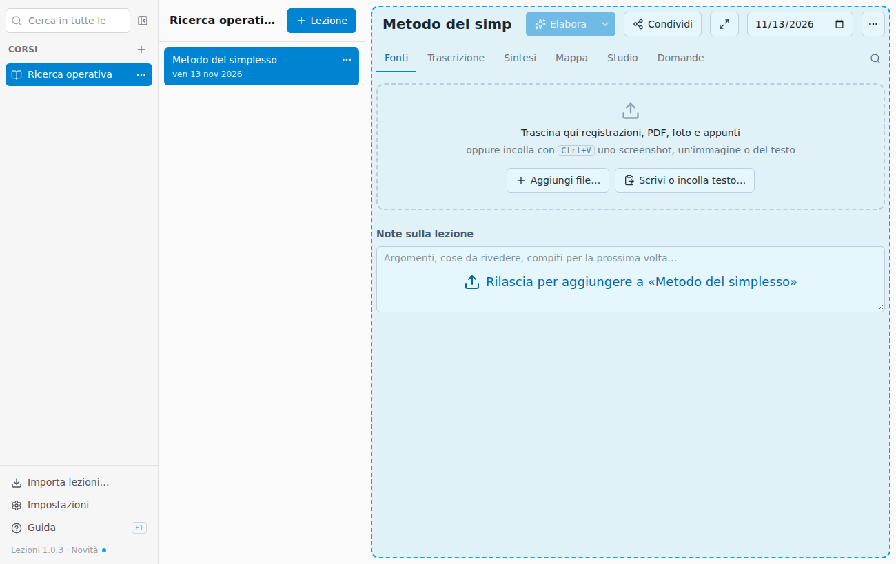
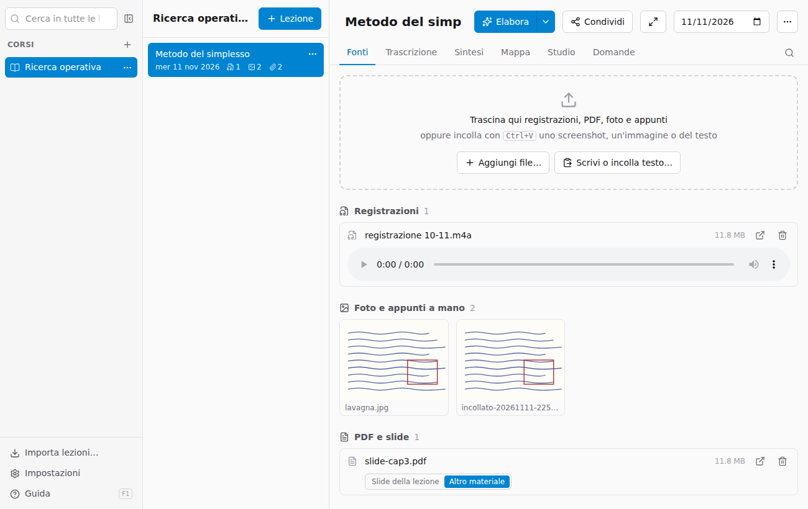
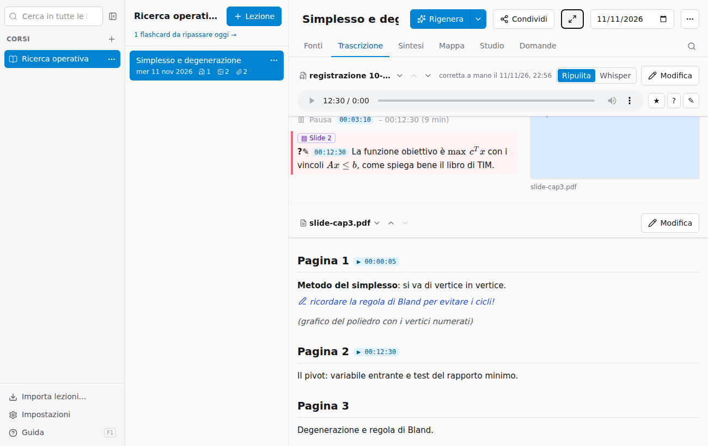

# Aggiungere le fonti

Le **fonti** sono tutto ciò che riguarda la lezione: registrazioni, foto, appunti dal tablet, slide, PDF, testo. I file vengono **copiati** nella cartella della lezione: gli originali restano dove sono.

## Trascinare i file

Trascina i file dal Finder o da Esplora file sopra la lezione aperta: la finestra si colora e, al rilascio, i file vengono aggiunti.

In alternativa usa **Aggiungi file…** per sceglierli da una finestra.

## Incollare

Con **⌘V** (Mac) o **Ctrl+V** (Windows), fuori da un campo di testo:

- uno **screenshot** o un'immagine copiata (per esempio dall'app di appunti del tablet) diventa una foto della lezione;
- del **testo** apre una finestra per dargli un titolo prima di aggiungerlo.

**Scrivi o incolla testo…** apre la stessa finestra per scrivere a mano. Il testo può essere in Markdown.

## Che file vanno bene

| Tipo | Formati | Note |
|---|---|---|
| Registrazioni | m4a, mp3, wav, aac, ogg, flac, opus | m4a (Memo vocali di iPhone e quasi tutti i registratori Android), mp3, wav, flac e ogg vengono divisi dall'app in parti di 20 minuti e costano meno; opus e formati rari vengono inviati interi |
| Video | mp4, mov, webm | Viene trascritto l'audio |
| Foto e appunti | jpg, png, heic, webp | Appunti a mano, lavagna, pagine del tablet esportate come immagine |
| PDF | pdf | Slide, dispense, appunti esportati dal tablet |
| Testo | txt, md | Usato così com'è |
| Office | docx, pptx, … | Non vengono letti: esportali in PDF e aggiungi il PDF |

Le fonti sono raggruppate per tipo. Le registrazioni si ascoltano direttamente nella pagina; le foto si vedono in miniatura. Il pulsante con la freccia apre il file con l'app del sistema, il cestino lo rimuove dalla lezione: va nel Cestino del computer la **copia** che Lezioni tiene nell'archivio (il file originale che avevi trascinato resta dov'era) e la trascrizione o il testo estratto vengono cancellati, quindi rimuovere una registrazione già trascritta significa doverla ritrascrivere se la aggiungi di nuovo.

> **Consiglio per gli appunti dal tablet.** Se usi GoodNotes, Notability, OneNote o simili, esporta le pagine della lezione in **PDF**: un PDF di più pagine è una sola fonte e viene letto meglio di tante foto.

## Slide della lezione o altro materiale

Nelle Fonti, sotto ogni PDF, scegli che cos'è:

- **Slide della lezione**: le slide che il docente proiettava mentre parlava. L'app le **collega alla registrazione**: trova in quali minuti il docente passa da una slide all'altra (con il modello di lettura, circa un millesimo di dollaro per lezione). Nella Trascrizione le vedi accanto al testo (vedi [Studiare](05-studiare.md#slide-accanto-alla-trascrizione)).
- **Altro materiale**: appunti, dispense, esercizi, documenti extra. Restano a parte: entrano nella sintesi, ma non vengono collegati alla registrazione.

Quando legge un PDF, l'app propone da sola il tipo (accanto compare «proposto»); se sbaglia, cambialo con un clic. Il collegamento si fa da solo all'elaborazione; dopo aver cambiato il tipo non serve rielaborare: **Collega alla registrazione** lo fa subito, **Ricollega** lo rifà.

## Appunti a mano su slide e foto

PDF e foto vengono letti dal modello come immagini, pagina per pagina: vede anche quello che hai scritto a mano sopra una slide stampata o una dispensa, le evidenziature e le frecce. Questi appunti finiscono nel testo letto nel punto in cui sono, ognuno su una riga sua, e nell'app si vedono **in blu, con una matita** davanti, così li distingui dal testo stampato (nel file Markdown sono scritti come *(nota a mano: …)*); per un'evidenziatura viene scritto cosa è evidenziato. Così entrano anche nella sintesi e nelle domande. Una grafia molto difficile può essere letta male: controlla nella scheda Trascrizione, dove ogni fonte ha il suo testo e si corregge con **Modifica**. Con OpenRouter un PDF può pesare fino a 50 MB (provato con 59 pagine di slide annotate, 33 MB: circa mezzo minuto e 3 centesimi).

