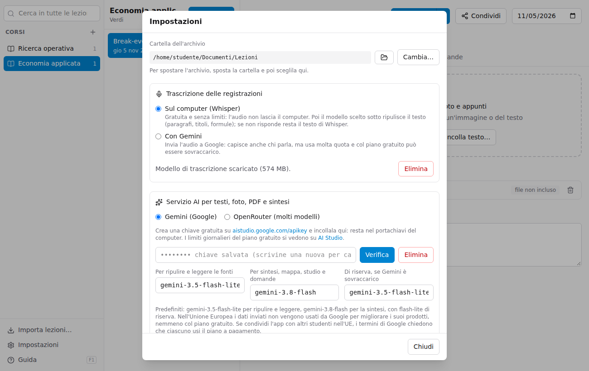
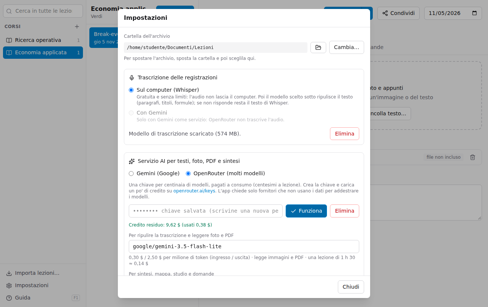
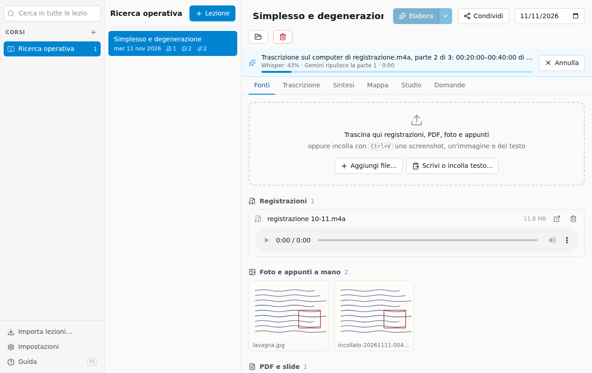

# Elaborare le lezioni

Le **registrazioni** vengono trascritte sul tuo computer con **Whisper**, gratis e senza limiti: l'audio non lascia il computer. Un **servizio di intelligenza artificiale** ripulisce poi la trascrizione, legge foto e PDF e scrive sintesi, mappa e materiale di studio. Il servizio lo scegli nelle Impostazioni:

- **Gemini** (Google): ha un piano gratuito, ma nelle ore di punta Google lo rifiuta spesso («sovraccarico»);
- **OpenRouter**: una sola chiave per centinaia di modelli (Google, Anthropic, OpenAI, DeepSeek…), pagati a consumo. Con la trascrizione sul computer una lezione costa pochi centesimi, e a fine elaborazione l'app dice quanto è costata davvero.

## Con Gemini (una volta sola)

1. Vai su [aistudio.google.com/apikey](https://aistudio.google.com/apikey) con il tuo account Google e crea una chiave (è gratuita).
2. In Lezioni apri **Impostazioni**, scegli **Gemini (Google)**, incolla la chiave e premi **Verifica e salva**.

I **modelli** predefiniti sono `gemini-3.5-flash-lite` per ripulire la trascrizione e leggere le fonti (veloce, ed è libero anche quando l'altro è sovraccarico) e `gemini-3.8-flash` per sintesi, mappa, studio e domande. Il **modello di riserva** (predefinito `gemini-3.5-flash-lite`) viene usato per una richiesta quando Google risponde due volte di fila che il primo è sovraccarico; l'app lo dice al termine. Lascialo vuoto per riprovare sempre con lo stesso modello.

## Con OpenRouter (una volta sola)

1. Crea un account su [openrouter.ai](https://openrouter.ai), carica un po' di credito (bastano pochi euro per molte lezioni) e crea una chiave su [openrouter.ai/keys](https://openrouter.ai/keys).
2. In Lezioni apri **Impostazioni**, scegli **OpenRouter**, incolla la chiave e premi **Verifica e salva**: l'app mostra il credito residuo.

Per ogni modello l'app mostra il prezzo, se legge immagini e PDF e quanto costerebbe circa una lezione di 1 h 30. I predefiniti sono `google/gemini-3.5-flash-lite` per ripulire e leggere (il più veloce) e `anthropic/claude-haiku-5.5` per la sintesi (la più fedele a quello che è stato detto), con flash-lite di riserva. Il campo suggerisce tutti i modelli del listino: scrivi parte del nome per cercarli.

- Il modello per **ripulire e leggere** deve leggere le immagini, altrimenti foto e appunti a mano vengono saltati: l'app te lo segnala.
- Per **confrontare** due modelli, cambia quello della sintesi e premi **Rigenera**: la versione precedente resta in `generati/versioni`, e la notifica finale dice quanto è costata la nuova.
- L'app chiede a OpenRouter solo fornitori che **non usano i dati** per addestrare i modelli.
- Con OpenRouter le registrazioni si trascrivono sempre sul computer.

La chiave, di Gemini o di OpenRouter, resta nel **portachiavi** del computer (Portachiavi su Mac, Gestione credenziali su Windows), non nei file dell'archivio.

## Elaborare una lezione

Premi **Elabora** in alto nella lezione. Una barra mostra a che punto è:

1. ogni **registrazione** viene divisa in parti di 20 minuti e trascritta sul computer da Whisper, una parte alla volta. Mentre Whisper fa la parte successiva, il modello scelto ripulisce quella già pronta: toglie intercalari e ripetizioni, corregge le parole riconosciute male, divide in paragrafi con titoli, scrive le formule in LaTeX e segna gli interventi degli studenti, mantenendo i minuti;
2. **foto e PDF** vengono letti, con le formule e la descrizione di grafici e schemi;
3. da **tutte le fonti insieme**, più le tue note, vengono scritte sintesi, mappa, flashcard, domande d'esame e glossario.

Sotto la barra, una seconda riga dice cosa sta aspettando (l'avanzamento di Whisper, la risposta del modello, un nuovo tentativo se il servizio è occupato) e da quanto tempo. Puoi continuare a usare l'app mentre lavora, anche su altre lezioni; **Annulla** la ferma.

### La trascrizione sul computer

- La prima volta l'app scarica il **modello di trascrizione** (574 MB, una volta sola). Puoi scaricarlo prima da **Impostazioni → Trascrizione delle registrazioni → Scarica ora**: il download continua anche se chiudi le Impostazioni, e riaprendole vedi a che punto è (o lo annulli).
- Su un Mac con chip Apple (M1 e successivi) è veloce: circa 1 minuto ogni 10 minuti di lezione. Su computer più vecchi o senza scheda grafica può richiedere quanto la registrazione stessa.
- Se il modello non riesce a ripulire una parte (per esempio il servizio è sovraccarico), resta il testo di Whisper, già con i minuti, e l'app lo segnala: la ripulitura viene ritentata alla prossima elaborazione.
- Con Gemini come servizio puoi scegliere invece la trascrizione **Con Gemini**: l'audio viene inviato a Google, che riconosce anche chi parla, ma usa molta quota e col piano gratuito a volte è sovraccarico.

## Rielaborare

- **Rigenera** rifà sintesi, mappa e studio **riusando le trascrizioni già fatte**: costa poco. Utile dopo aver aggiunto appunti o slide, o per provare un altro modello.
- Dalla freccia accanto: **Rielabora anche le fonti** rifà anche trascrizioni e letture.
- Le versioni precedenti di sintesi e mappa restano in `generati/versioni` nella cartella della lezione.

Se l'elaborazione si interrompe (connessione, quota esaurita), le parti di registrazione già trascritte sono salvate: la volta dopo riparte da lì. In quel caso la sintesi non viene scritta, per non farne una senza la registrazione.

## Costi e limiti

- **Gemini, piano gratuito**: non paghi nulla, ma c'è un limite di richieste al giorno (lo vedi su [AI Studio](https://aistudio.google.com/rate-limit)) e nelle ore di punta le richieste vengono spesso rifiutate.
- **Gemini con la fatturazione** attiva su Google: pochi centesimi a lezione con la trascrizione sul computer; con la trascrizione **Con Gemini** circa 0,30–0,40 $ con `gemini-3.8-flash`. A fine elaborazione l'app mostra i token usati e quanto sarebbero costati.
- **OpenRouter**: a consumo, dal credito caricato. Con i modelli predefiniti una lezione di 1 h 30 costa qualche centesimo; a fine elaborazione l'app mostra il **costo reale**.

## Privacy

Con la trascrizione sul computer l'audio resta sul computer; al servizio scelto vanno il testo trascritto, le foto, i PDF e le note. Con la trascrizione **Con Gemini** viene inviato anche l'audio. Per chi è nell'Unione Europea, Google non usa questi dati per migliorare i propri prodotti, nemmeno con il piano gratuito; con OpenRouter l'app esclude i fornitori che li userebbero. Evita comunque di inserire dati personali sensibili.
