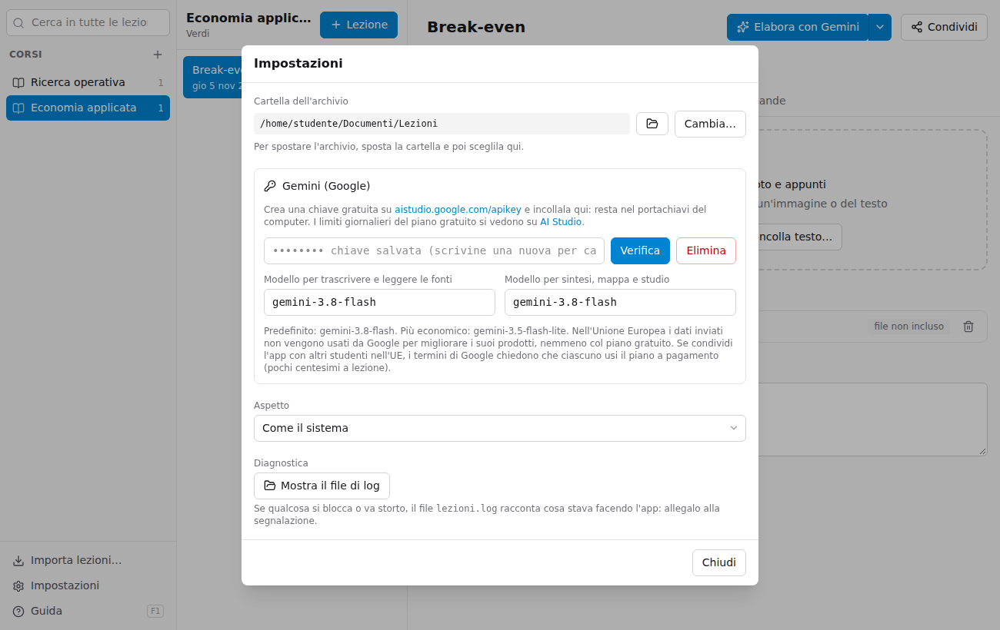
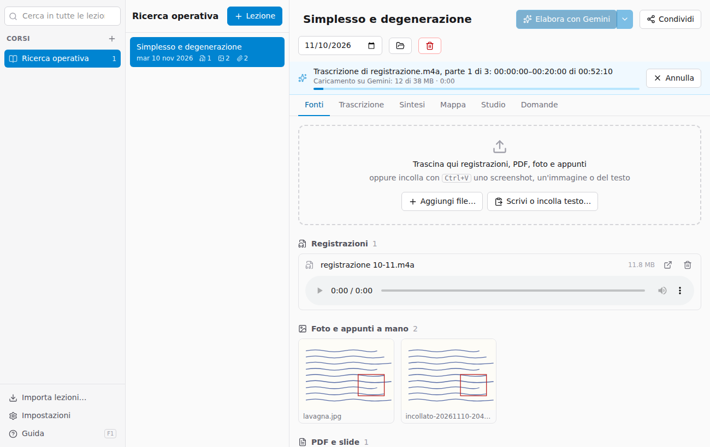

# Elaborare con Gemini

L'app usa **Gemini**, l'intelligenza artificiale di Google, per trascrivere le registrazioni, leggere foto e PDF e scrivere sintesi, mappa e materiale di studio.

## La chiave API (una volta sola)

1. Vai su [aistudio.google.com/apikey](https://aistudio.google.com/apikey) con il tuo account Google e crea una chiave (è gratuita).
2. In Lezioni apri **Impostazioni**, incolla la chiave e premi **Verifica e salva**.

La chiave resta nel **portachiavi** del computer (Portachiavi su Mac, Gestione credenziali su Windows), non nei file dell'archivio.

Nelle impostazioni puoi anche scegliere i **modelli**: quello predefinito è `gemini-3.8-flash`; `gemini-3.5-flash-lite` costa circa la metà ed è un po' meno accurato.

## Elaborare una lezione

Premi **Elabora con Gemini** in alto nella lezione. Una barra mostra a che punto è:

1. ogni **registrazione** viene divisa in parti di 20 minuti e trascritta una parte alla volta: ogni parte viene caricata su Gemini (circa 38 MB) e trascritta in 1–3 minuti, quindi una lezione di 2 ore richiede in tutto 10–20 minuti;
2. **foto e PDF** vengono letti, con le formule e la descrizione di grafici e schemi;
3. da **tutte le fonti insieme**, più le tue note, vengono scritte sintesi, mappa, flashcard, domande d'esame e glossario.

Sotto la barra, una seconda riga dice cosa sta aspettando (il caricamento con i MB inviati, la risposta di Gemini, un nuovo tentativo se Gemini è occupato) e da quanto tempo. Puoi continuare a usare l'app mentre lavora, anche su altre lezioni; **Annulla** la ferma.

## Rielaborare

- **Rigenera** rifà sintesi, mappa e studio **riusando le trascrizioni già fatte**: costa poco. Utile dopo aver aggiunto appunti o slide.
- Dalla freccia accanto: **Rielabora anche le fonti** rifà anche trascrizioni e letture.
- Le versioni precedenti di sintesi e mappa restano in `generati/versioni` nella cartella della lezione.

Se l'elaborazione si interrompe (connessione, quota esaurita), le parti di registrazione già trascritte sono salvate: la volta dopo riparte da lì. In quel caso la sintesi non viene scritta, per non farne una senza la registrazione.

## Costi e limiti

- Con il **piano gratuito** di Google non paghi nulla, ma c'è un limite di richieste al giorno (lo vedi su [AI Studio](https://aistudio.google.com/rate-limit)). Se lo superi, l'app lo dice: riprova il giorno dopo.
- Con la **fatturazione** attiva su Google, una lezione di 2 ore costa circa 0,30–0,40 $ con `gemini-3.8-flash` (circa 0,20 $ con `gemini-3.5-flash-lite`). Al termine di ogni elaborazione l'app mostra i token usati e quanto sarebbero costati.

## Privacy

Audio, foto e testi vengono inviati a Google per l'elaborazione. Per chi è nell'Unione Europea, Google non usa questi dati per migliorare i propri prodotti, nemmeno con il piano gratuito. Evita comunque di inserire dati personali sensibili.
