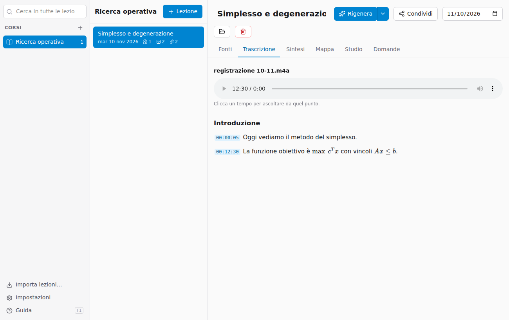
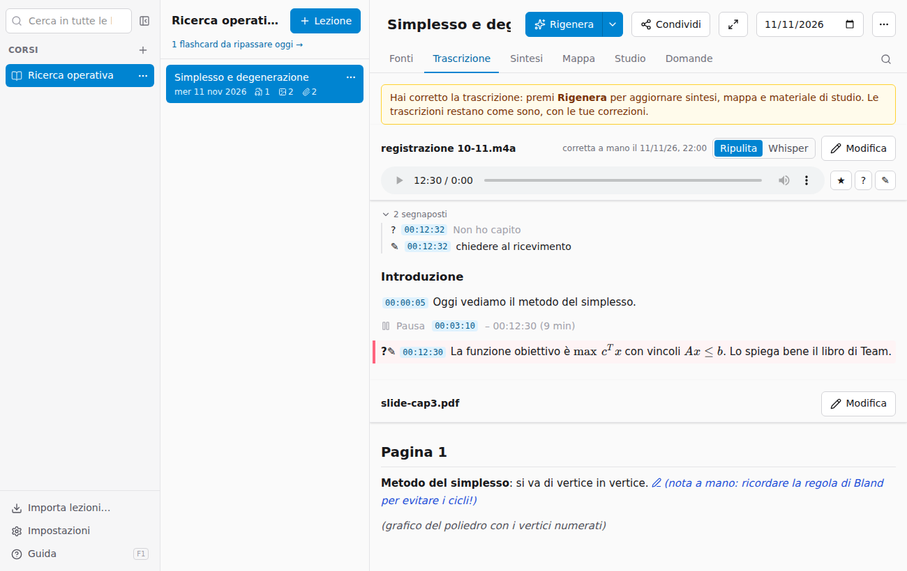
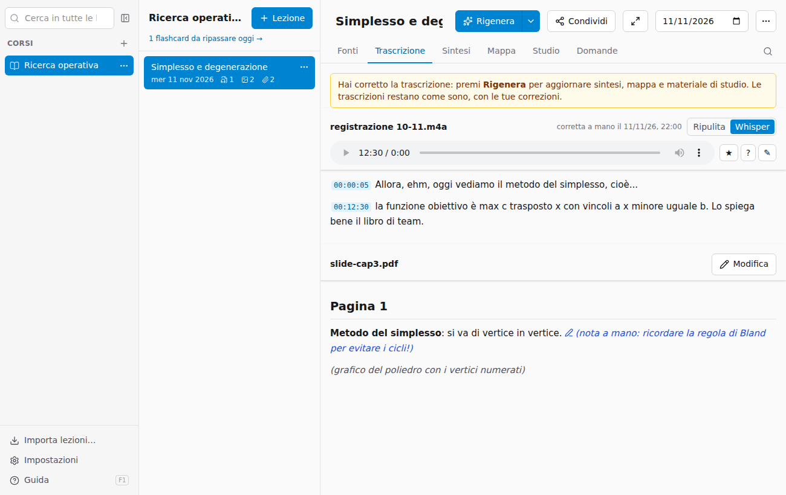
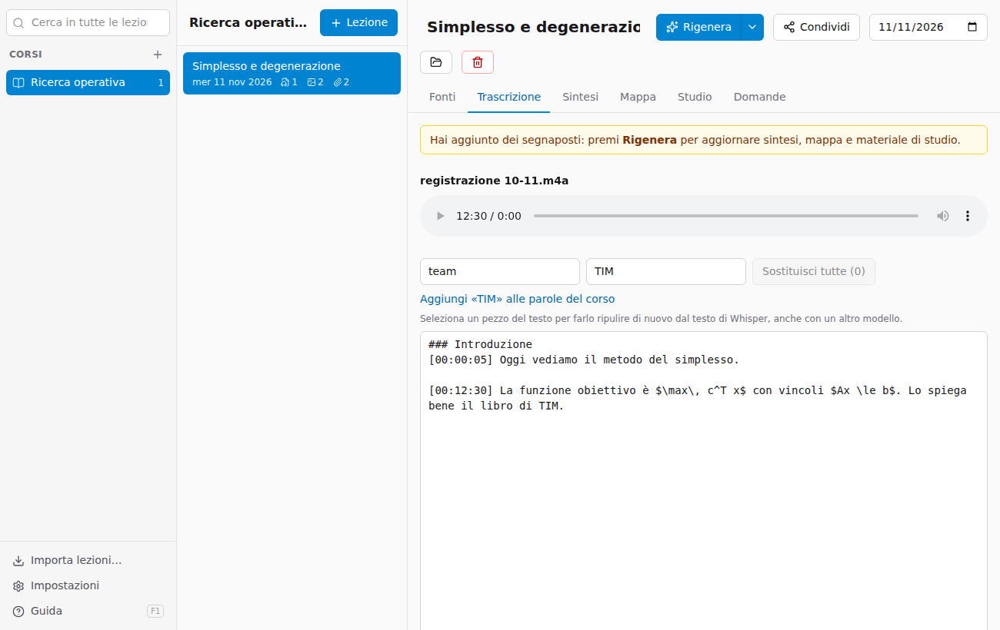
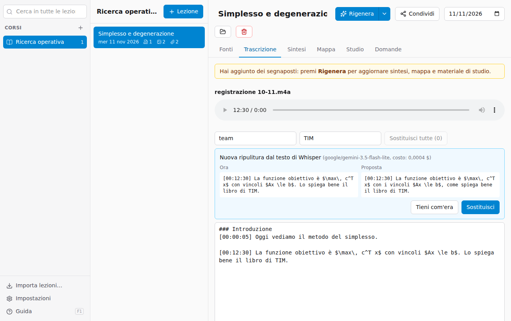
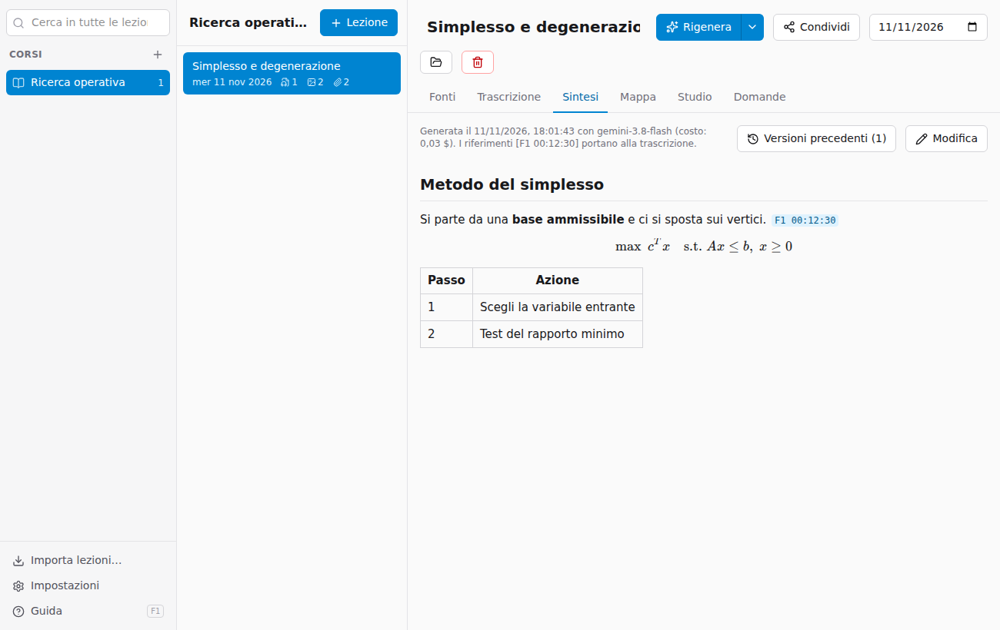
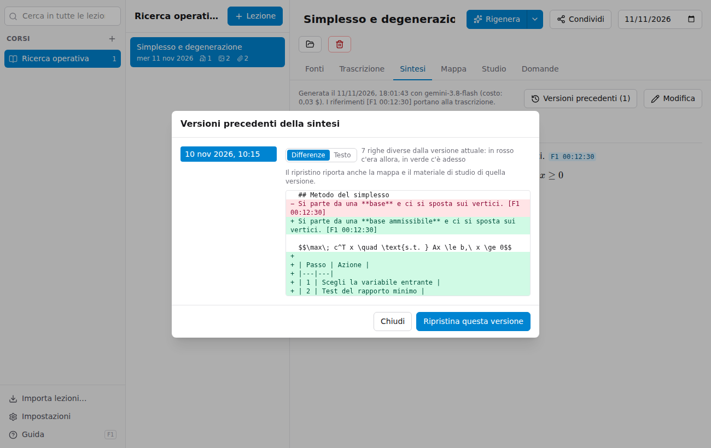
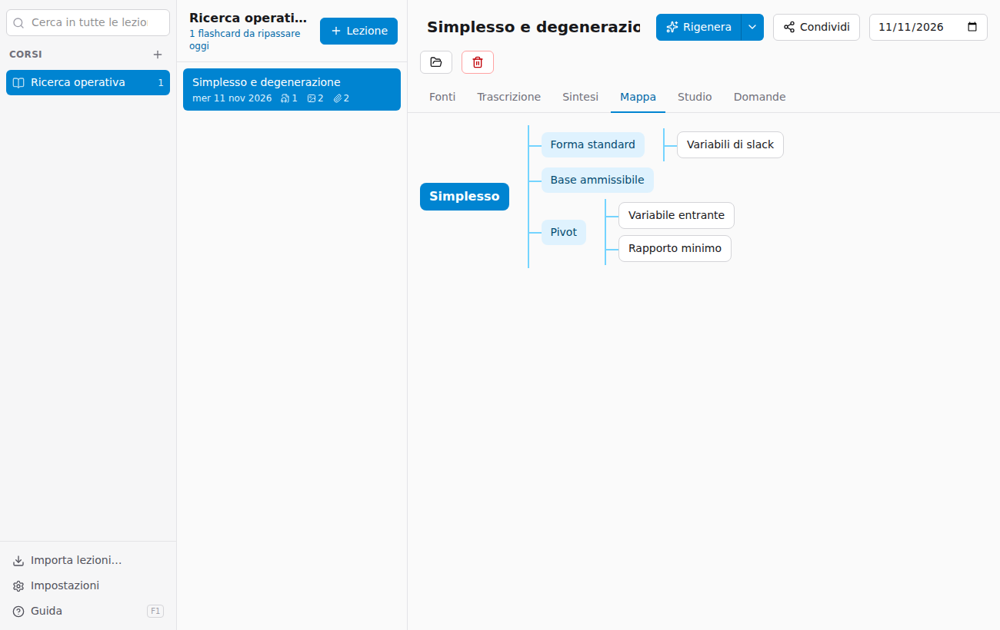
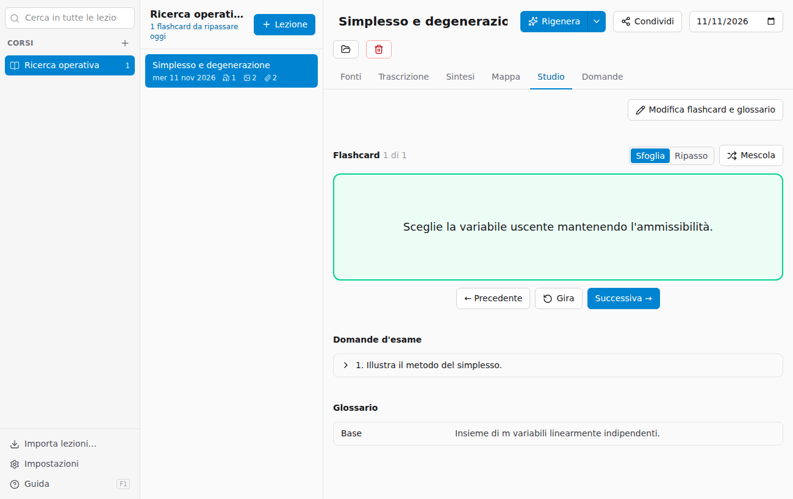
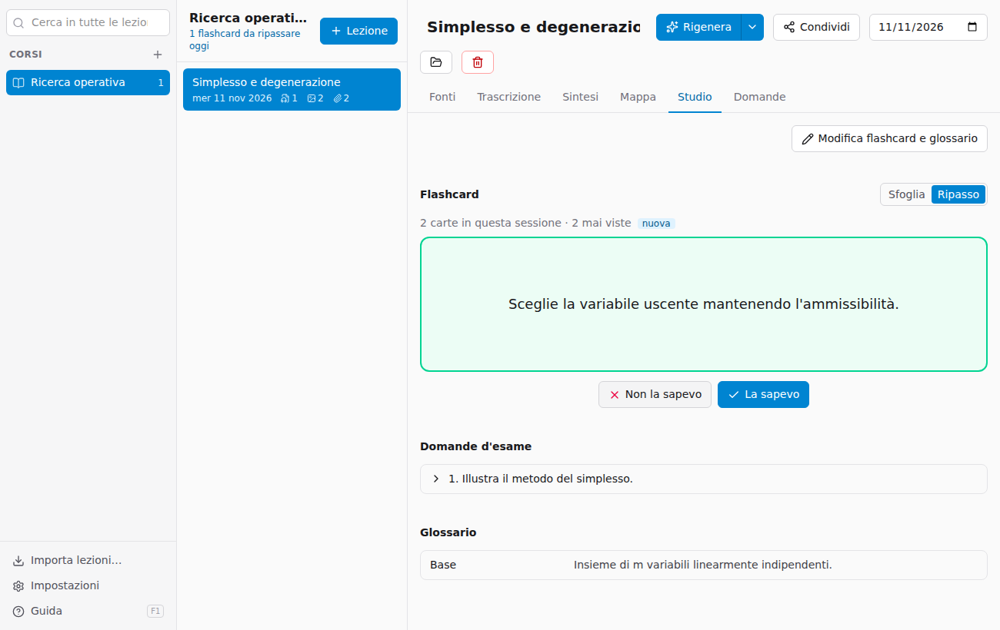

# Studiare: trascrizione, sintesi, mappa, studio

## Trascrizione

La scheda **Trascrizione** mostra il testo di ogni fonte: le registrazioni trascritte e il contenuto letto da foto e PDF. Il testo è ripulito da intercalari e ripetizioni, diviso in paragrafi, con titoli quando cambia argomento e formule scritte come formule.

Ogni paragrafo inizia con il **minuto** in cui comincia: cliccalo e la registrazione riparte da lì.

### Segnaposti mentre ascolti

Mentre riascolti una registrazione puoi segnare i punti che contano. Sotto il lettore:

- **★ Importante** (tasto **I**): un punto da ricordare.
- **? Non ho capito** (tasto **D**): un passaggio da chiarire.
- **✎ Nota** (tasto **N**): un punto con una nota tua, per esempio «chiedere al ricevimento».

Il segnaposto prende il minuto a cui sei arrivato. I tasti valgono per la registrazione che stai ascoltando, quando non stai scrivendo in un campo di testo. Nella trascrizione il paragrafo di quel minuto è evidenziato con l'icona; sotto il lettore c'è l'elenco dei segnaposti, dove clicchi il minuto per riascoltare, clicchi il testo per scrivere o cambiare la nota, e il cestino per eliminarlo.

Con **Rigenera** la sintesi dà più spazio ai punti importanti e spiega con più calma quelli che non hai capito. Anche le **Domande** li conoscono: puoi chiedere «spiegami i punti che non ho capito». I segnaposti sono nel file `segnaposti.json` della lezione e viaggiano nei pacchetti, come le note.

### Il testo di Whisper

Per le registrazioni trascritte sul computer, l'interruttore **Ripulita | Whisper** mostra il testo come l'ha riconosciuto Whisper, prima che il modello lo ripulisse. Serve a controllare un passaggio dubbio: se la versione ripulita dice qualcosa di strano, il testo di Whisper mostra cosa è stato sentito davvero (e il minuto per riascoltarlo).

### Correggere la trascrizione

**Modifica** apre il testo di una fonte per correggerlo a mano: è Markdown, con i minuti tra parentesi quadre all'inizio dei paragrafi (lasciali come sono, servono per i riferimenti). In alto, **Trova** e **Sostituisci tutte** correggono in un colpo una parola sbagliata in tutto il testo, senza distinguere maiuscole e minuscole.

- Dopo una sostituzione puoi **aggiungere la parola alle parole del corso** (vedi [Corsi](02-archivio.md#corsi)): così le prossime lezioni la riconoscono già giusta.
- **Salva** conserva la correzione; la fonte mostra «Corretta a mano». La correzione vale per la ricerca, le domande, le esportazioni e i pacchetti.
- Sintesi, mappa e studio non cambiano da soli: premi **Rigenera** per rifarli con il testo corretto (l'app lo ricorda con un avviso).
- **Ripulisci di nuovo un pezzo**: se un passaggio è venuto male, selezionalo nel testo (bastano poche parole: vale il paragrafo intero) e premi **Ripulisci di nuovo la selezione**. Il modello rifà la ripulitura di quei paragrafi partendo dal testo di Whisper; puoi scegliere un altro modello dalla tendina. Vedi il testo attuale e la proposta affiancati e scegli **Sostituisci** o **Tieni com'era**; poi **Salva** come per ogni correzione. Costa una frazione di centesimo e serve il testo di Whisper (le lezioni elaborate prima di questa versione ce l'hanno solo dopo *Rielabora anche le fonti*).

- **Rielabora anche le fonti** rifà la trascrizione da capo: l'app chiede conferma e conserva la versione corretta in `estratti/versioni` nella cartella della lezione.

## Sintesi

La **Sintesi** mette insieme tutte le fonti in un testo ordinato, con titoli, elenchi, tabelle, formule ed esempi. Alla fine di ogni paragrafo ci sono i **riferimenti**: **F1 00:12:30** vuol dire «fonte 1, al minuto 12:30». Cliccandolo si apre la trascrizione con la registrazione già a quel punto: comodo per riascoltare un passaggio poco chiaro.

Anche la sintesi si corregge con **Modifica**, con lo stesso trova e sostituisci. Con **Rigenera** la versione corretta non si perde: resta in `generati/versioni`.

### Versioni precedenti

Ogni volta che premi **Rigenera**, sintesi, mappa e materiale di studio di prima diventano una **versione precedente**. Lo stesso vale per una trascrizione corretta a mano e poi rifatta con *Rielabora anche le fonti*. Il pulsante **Versioni precedenti** (nella Sintesi, e accanto a ogni trascrizione che ne ha) apre l'elenco per data:

- **Differenze** confronta la versione con quella attuale riga per riga: in rosso quello che c'era allora, in verde quello che c'è adesso. **Testo** la mostra intera.
- **Ripristina questa versione** la riporta come attuale. Per la sintesi tornano insieme anche la mappa e il materiale di studio di quella versione. Quella che sostituisci non si perde: diventa a sua volta una versione precedente.

## Mappa

La **Mappa** mostra gli argomenti della lezione ad albero: al centro l'argomento principale, poi i concetti e i sotto-concetti. Clicca un concetto per chiuderne o aprirne i rami.

## Studio

- **Flashcard**: in **Sfoglia** clicca la carta per vedere la risposta, poi *Successiva*; **Mescola** cambia l'ordine. In **Ripasso** vedi solo le carte da ripassare oggi (vedi sotto).
- **Domande d'esame**: domande come all'esame; clicca una domanda per vedere la traccia di risposta.
- **Glossario**: i termini tecnici della lezione, in ordine alfabetico.

### Ripasso a intervalli

In **Ripasso** l'app ti propone le flashcard da ripassare oggi. Pensa alla risposta, premi **Mostra la risposta** e poi dì com'è andata:

- **La sapevo**: la carta torna fra 1 giorno, poi fra 3, 7, 14 e 30 se continui a saperla.
- **Non la sapevo**: la carta torna in fondo alla sessione di oggi e il conto riparte da capo.

Le carte mai viste entrano al massimo **20 per volta**, così un corso intero non parte con centinaia di carte; finita la sessione, *Altre carte nuove* ne propone altre. Lo stesso ripasso, con le carte di **tutte le lezioni** del corso, è nella **pagina del corso** (clic sul nome del corso sopra le lezioni), e sotto il nome del corso compare quante carte ci sono da ripassare oggi. Ogni carta indica la lezione da cui viene.

Con *Rigenera* le carte che restano uguali (stessa domanda) conservano il loro punto nel ripasso. I progressi sono nel file `ripasso.json` della lezione e non entrano nei pacchetti che condividi.

**Modifica flashcard e glossario** trasforma flashcard, domande d'esame e glossario in un elenco di campi: correggi il testo, elimina le voci sbagliate con il cestino o aggiungine di tue con **Aggiungi**, poi **Salva**. Le voci lasciate vuote non vengono salvate.

> Il materiale è scritto dall'intelligenza artificiale a partire dalle tue fonti: è un aiuto per studiare, non un sostituto. Se qualcosa non torna, controlla nella trascrizione o riascolta il punto indicato.
