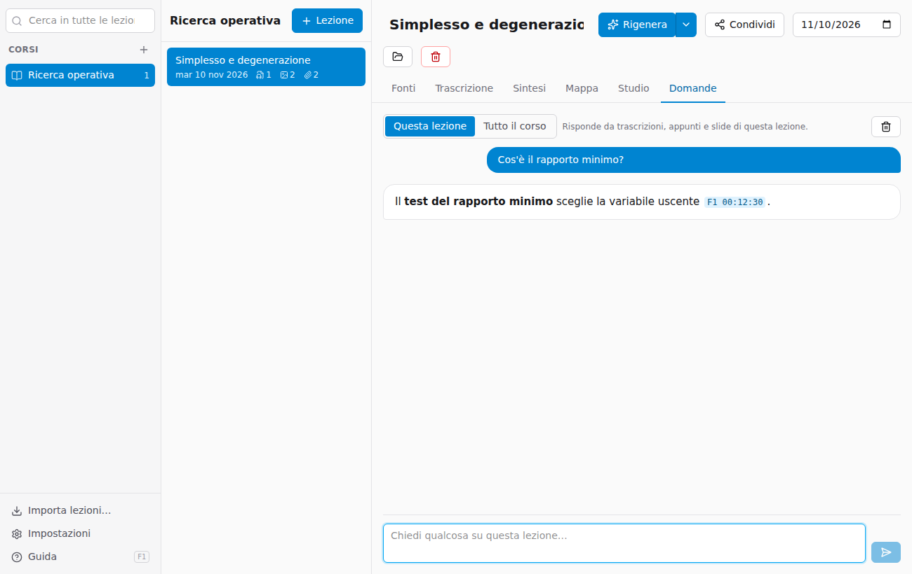

# Domande sulla lezione o sul corso

La scheda **Domande** è una chat in cui chiedere spiegazioni, esempi o collegamenti. Le risposte vengono **solo dal tuo materiale** e citano le fonti.

In alto scegli dove cercare la risposta:

- **Questa lezione**: Gemini legge trascrizioni, appunti e slide della lezione. Nei riferimenti, **F1 00:12:30** riapre la registrazione a quel minuto.
- **Tutto il corso**: Gemini legge le **sintesi** di tutte le lezioni del corso (non le trascrizioni intere, che sarebbero troppo lunghe e costose). I riferimenti come **L3** aprono la lezione citata.

Per **Tutto il corso** le lezioni devono essere già state elaborate.

Consigli:

- chiedi cose precise: «Spiegami il passaggio dal tableau iniziale alla prima iterazione», «Fammi un esempio numerico del test del rapporto minimo»;
- puoi fare domande di seguito: la chat ricorda le domande precedenti;
- se la risposta non è nelle fonti, la chat lo dice; una spiegazione generale viene segnalata come «(non dalle fonti)».

Invio manda la domanda, **Maiusc+Invio** va a capo. Il cestino cancella la conversazione mostrata.

Le conversazioni restano nella cartella della lezione (`chat.json`) e **non vengono mai incluse** quando condividi la lezione.
