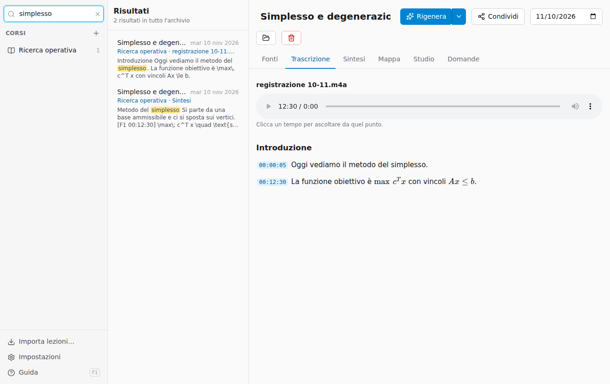

# Cercare nell'archivio

Il campo **Cerca in tutte le lezioni**, in alto a sinistra, cerca in tutto l'archivio: titoli, note, trascrizioni, testi letti da foto e PDF, sintesi, flashcard e glossari.

- Accenti e maiuscole non contano: *citta* trova *città*.
- Con più parole, ogni risultato le contiene tutte (anche non vicine).
- Ogni risultato dice in quale **corso**, **lezione** e **parte** si trova (per esempio la registrazione e il minuto) e mostra il testo intorno, con le parole evidenziate.
- Cliccando un risultato si apre la lezione nella scheda giusta; per una trascrizione, la registrazione è già al minuto trovato.

**Esc** o la **×** svuotano la ricerca e riportano all'elenco dei corsi.
