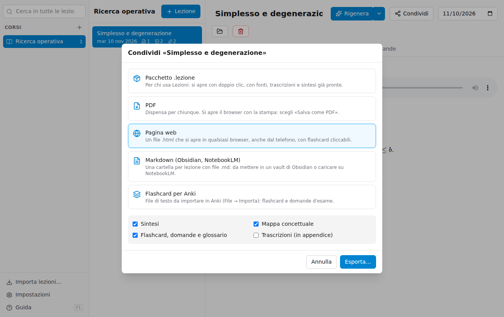
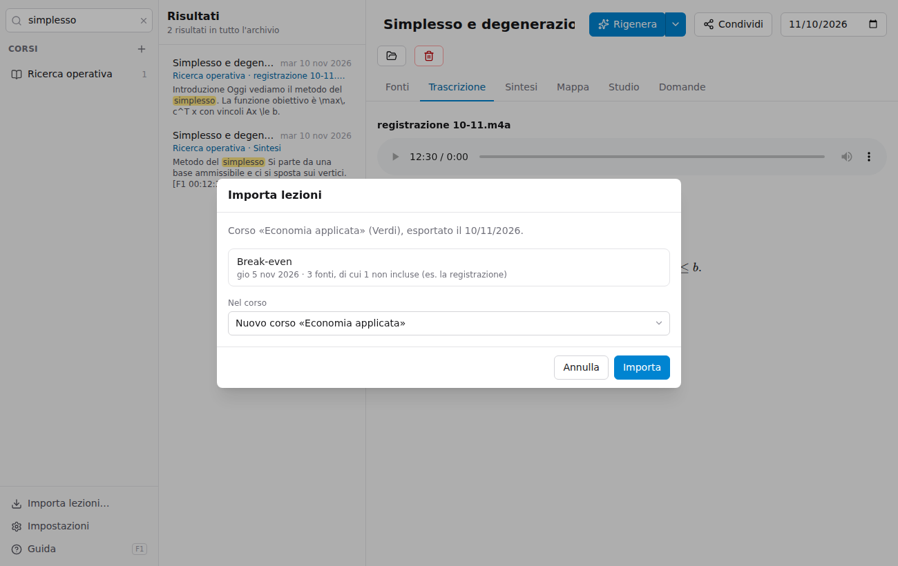

# Condividere con i compagni

**Condividi**, in alto nella lezione, esporta la lezione; **Esporta il corso** (passando col mouse sul corso) esporta tutte le lezioni di un corso. I file creati si mandano come si vuole: WhatsApp, mail, Google Drive.

| Formato | Per chi | Cosa contiene |
|---|---|---|
| **Pacchetto .lezione** | Chi usa Lezioni | La lezione completa: fonti, trascrizioni, sintesi, mappa, studio. Si apre con un doppio clic e non serve rielaborarla |
| **PDF** | Chiunque | Una dispensa con sintesi, mappa, flashcard, domande e glossario, e a scelta le trascrizioni in appendice |
| **Pagina web** | Chiunque | Lo stesso contenuto in un file `.html` che si apre in qualsiasi browser, anche dal telefono e senza internet, con le flashcard cliccabili |
| **Markdown** | Chi usa Obsidian o NotebookLM | Una cartella per lezione con Sintesi, Mappa, Studio e Trascrizioni in file `.md` |
| **Flashcard per Anki** | Chi ripassa con Anki | Un file di testo da importare in Anki con *File → Importa* |

## Pacchetto .lezione: cosa viaggia

- **Registrazioni**: escluse di default, perché pesano molto e per diffonderle serve il permesso del docente. La loro **trascrizione viaggia comunque**: chi riceve il pacchetto vede la fonte come «file non incluso», ma ha il testo.
- **Foto, PDF e appunti**: inclusi di default.
- **Le tue note sulla lezione**: escluse, a meno che tu non scelga di includerle.
- **Le conversazioni della scheda Domande**: mai incluse.

## PDF

Scegliendo **PDF** si apre il browser con la finestra di stampa: come stampante scegli **Salva come PDF** (su Mac in basso a sinistra, su Windows «Microsoft Print to PDF»). Le flashcard compaiono già girate, con la risposta.

## Importare un pacchetto ricevuto

Fai doppio clic sul file `.lezione`, oppure trascinalo nella finestra, oppure usa **Importa lezioni…** in basso a sinistra.

La finestra mostra le lezioni contenute e propone il corso con lo stesso nome (o ne crea uno nuovo). Se una lezione è già nel tuo archivio puoi:

- **lasciarla com'è** e importare solo quelle nuove;
- **sostituirla** con quella ricevuta (la tua va nel Cestino);
- **tenerle entrambe**, come due lezioni separate.
