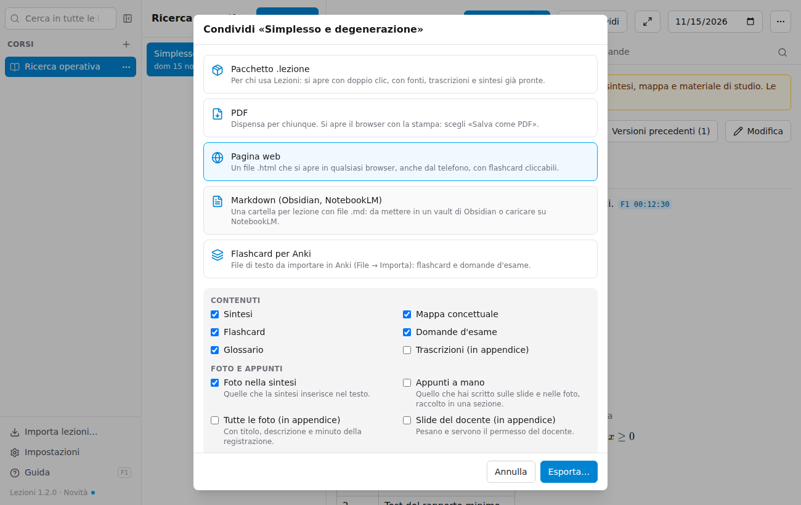
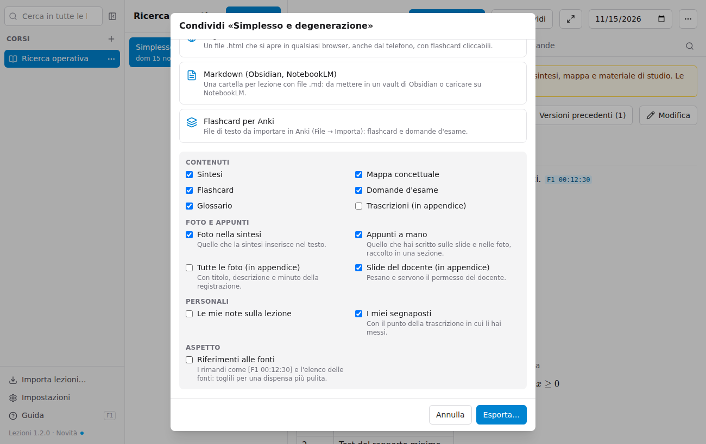
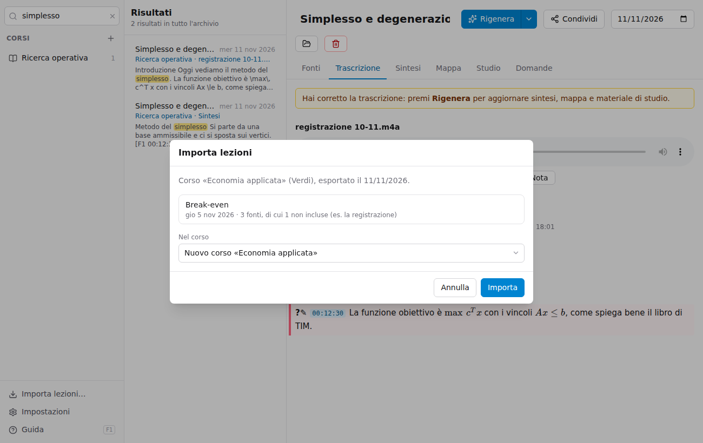

# Condividere con i compagni

**Condividi**, in alto nella lezione, esporta la lezione; **Esporta il corso** (passando col mouse sul corso) esporta tutte le lezioni di un corso, precedute dalla **sintesi del corso** con le sue domande d'esame, se l'hai generata (in PDF, pagina web e Markdown, dove diventa un file a parte accanto alle cartelle delle lezioni). I file creati si mandano come si vuole: WhatsApp, mail, Google Drive.

| Formato | Per chi | Cosa contiene |
|---|---|---|
| **Pacchetto .lezione** | Chi usa Lezioni | La lezione completa: fonti, trascrizioni, sintesi, mappa, studio. Si apre con un doppio clic e non serve rielaborarla |
| **PDF** | Chiunque | Una dispensa con sintesi, mappa (disegnata come nell'app), flashcard, domande e glossario; a scelta appunti a mano, foto, slide, le tue note e i tuoi segnaposti, e le trascrizioni in appendice. La sola mappa si esporta in PDF anche dalla scheda Mappa |
| **Pagina web** | Chiunque | Lo stesso contenuto in un file `.html` che si apre in qualsiasi browser, anche dal telefono e senza internet, con le flashcard cliccabili e la mappa disegnata come nell'app |
| **Markdown** | Chi usa Obsidian o NotebookLM | Una cartella per lezione con Sintesi, Mappa, Studio e Trascrizioni in file `.md` |
| **Flashcard per Anki** | Chi ripassa con Anki | Un file di testo da importare in Anki con *File → Importa* |

## Pacchetto .lezione: cosa viaggia

- **Registrazioni**: escluse di default, perché pesano molto e per diffonderle serve il permesso del docente. La loro **trascrizione viaggia comunque**: chi riceve il pacchetto vede la fonte come «file non incluso», ma ha il testo.
- **Foto, PDF e appunti**: inclusi di default.
- **Le tue note sulla lezione**: escluse, a meno che tu non scelga di includerle.
- **Le conversazioni della scheda Domande**: mai incluse.

## PDF

Scegliendo **PDF** si apre il browser con la finestra di stampa: come stampante scegli **Salva come PDF** (su Mac in basso a sinistra, su Windows «Microsoft Print to PDF»). Le flashcard compaiono già girate, con la risposta.

## PDF e pagina web: cosa includere

Sotto i formati scegli cosa mettere nella dispensa; l'app ricorda le scelte per la volta dopo.

- **Contenuti**: sintesi, mappa concettuale, flashcard, domande d'esame, glossario, e le trascrizioni in appendice (escluse di default).
- **Foto nella sintesi**: le foto che la sintesi inserisce nel testo, comprese quelle che hai messo tu. Togliendole resta la didascalia. Le foto vengono rimpicciolite e convertite in JPEG, così si vedono in qualsiasi browser anche se in origine sono HEIC dell'iPhone. Se un'immagine non si riesce a leggere, l'app te lo dice con il suo nome invece di lasciarla fuori senza avvisare.
- **Appunti a mano**: quello che hai scritto sopra slide, dispense e foto (vedi [Appunti a mano su slide e foto](03-fonti.md#appunti-a-mano-su-slide-e-foto)), raccolto in una sezione, per fonte e per pagina, in blu con la matita come nell'app.
- **Tutte le foto**: in appendice, con titolo, descrizione e il minuto della registrazione a cui sono agganciate.
- **Slide del docente**: le pagine dei PDF segnati come slide, in appendice, due per pagina in stampa. Rendono il file più pesante e per diffonderle serve il permesso del docente.
- **Le mie note sulla lezione** e **I miei segnaposti** (con il paragrafo della trascrizione in cui li hai messi): sono tuoi, quindi esclusi se non li spunti. Con le trascrizioni in appendice, i paragrafi con un segnaposto sono evidenziati come nell'app.
- **Riferimenti alle fonti**: i rimandi come [F1 00:12:30] e l'elenco delle fonti sotto la sintesi. Toglili per una dispensa più pulita da dare a chi non ha la registrazione.

## Importare un pacchetto ricevuto

Fai doppio clic sul file `.lezione`, oppure trascinalo nella finestra, oppure usa **Importa lezioni…** in basso a sinistra.

La finestra mostra le lezioni contenute e propone il corso con lo stesso nome (o ne crea uno nuovo). Se una lezione è già nel tuo archivio puoi:

- **lasciarla com'è** e importare solo quelle nuove;
- **sostituirla** con quella ricevuta (la tua va nel Cestino);
- **tenerle entrambe**, come due lezioni separate.
